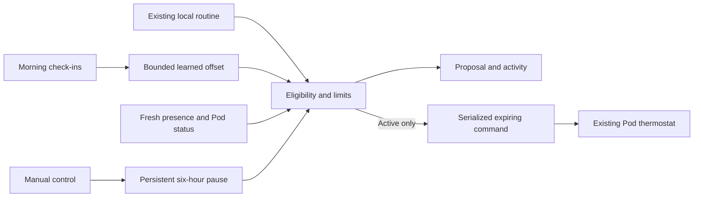

# Adaptive comfort

Implemented 2026-10-13. Experimental; local source tests and synthetic previews only. No overnight or physical Pod validation has been performed.

Eight Sleep describes its temperature system as responding to feedback, sleep and health metrics ([temperature schedule](https://help.eightsleep.com/en_us/what-is-the-temperature-schedule-BkRoPvR66), [Autopilot](https://www.eightsleep.com/autopilot/)). Free Sleep does not have a validated sleep-stage classifier. This implementation learns a small comfort offset from self-reported warm/cold check-ins and applies it to the existing routine. Its limits and learning rule are engineering choices, not clinical findings or a reproduction of Eight Sleep's model.

## Controls

Open Tonight → Comfort that learns, select the bed side, choose a mode and limits, then Save comfort settings. Web and native iOS expose the same settings and activity history.

| Mode | Behavior |
| --- | --- |
| Off (default) | Existing routines and manual controls continue; no learning or adaptive writes. |
| Preview | Calculates and records learning decisions without changing the Pod. |
| Active | Applies eligible learned targets while an enabled routine is running and the side is occupied. |

Default limits are 70–95°F. Choose limits within the Pod's existing 55–110°F range. Limits apply to adaptive commands; manually chosen temperatures and ordinary routines retain their existing behavior. If a routine target lies outside the selected limits, adaptive comfort waits instead of jumping to a boundary. Switching Off leaves the current target unchanged until you or your routine changes it.

## Learning and precedence

- At the first check of a routine session, evaluate unconsumed check-ins from the last 14 days for that side, excluding future dates. At least three distinct wake dates are required. A two-thirds warm majority lowers the learned offset by 1°F; a two-thirds cold majority raises it by 1°F. Otherwise retain the offset. Consume the evaluated dates, so repeatedly polling or restarting cannot learn again from the same reports. Edits to an already consumed date are not retraining events.
- Learn at most once per routine session. Clamp the accumulated offset to −3…+3°F. Reset returns the offset to zero and preserves the consumed-date cursor.
- Check every 30 seconds. Adaptive corrections are at least 30 minutes apart. User-programmed routine changes still run at their selected times; the same controller can add the learned offset to an eligible scheduled target.
- Manual temperature, power or duration changes from web, iOS, taps, HomeKit or Shortcuts pause adaptive comfort for six hours. The pause persists across a normal server restart. Ordinary routines continue during the pause. An unexplained target change also pauses adaptation instead of overriding it.
- No adaptive power-on, base motion, stage inference, LLM actuator tools, or cloud processing. The existing firmware remains responsible for reaching the requested water temperature.

## Conditions that withhold a correction

No single enabled routine window; equal start/end or overlapping windows; either side in away mode; active temperature-schedule override; active alarm override; the final half-hour before a scheduled alarm; priming; vibration alarm; low or unknown water level; side powered off; absent or stale presence; stale Pod status; cooldown; manual pause; an uncertain write or storage failure.

The biometrics stream now reports unchanged presence every 30 seconds, retries failed reports no more often than every five seconds, and never manufactures a fresh reading at server startup. API timestamps come from the server. Adaptive comfort rejects presence older than 90 seconds and Pod status older than 15 seconds. These checks depend on the quality and timeliness of the underlying stream; they are not validation of the presence classifier.

Commands use a current socket and carry an expiry checked inside the existing socket queue immediately before dispatch. The adaptive path does not wait for a reconnect or replay a failed command. Manual/scheduled/adaptive temperature operations share a queue. A failed adaptive write suspends automation in the running process and attempts to persist a six-hour pause. Check the Pod before restarting the server after a fault. If storage itself is unavailable, the in-memory suspension cannot guarantee persistence across a restart.

## Storage and API

`DATA_FOLDER/analytics/comfort.json` stores side-specific settings, offset, consumed-date cursor, manual pause, last request and the last 60 activity entries. Writes use private file permissions and atomic replacement outside the LowDB folder watched by the scheduler. Existing malformed data is preserved and automation is withheld. Journal notes are not copied into comfort state.

- `GET /api/comfort?side=left`: configuration, offset, proposal/withholding reason, pause and activity.
- `POST /api/comfort`: `{ "side": "left", "config": { "mode": "preview", "minimumF": 70, "maximumF": 95 }, "reset": false }`.
- `POST /api/comfort/mode`: `{ "side": "left", "mode": "preview" }`. Returns 204 after saving. Used by Shortcuts to change only the mode; the latest limits, learning and manual pause remain intact. Requests cannot include limits or reset learning.

The authenticated Replit gateway allows these routes. Mode changes and full configuration edits share the same serialized controller queue. A Shortcut therefore cannot restore limits from a stale read. Update the server and gateway before using the mode-only Shortcut; older deployments reject it without a fallback write. A proposal or requested-target activity entry is not physical confirmation. Observe actual Pod targets and water temperatures during qualification.

## Qualification still needed

First deploy on the Pod with mode Off, confirm normal controls and routines, and verify the new presence heartbeat. Run Preview across actual routine boundaries, sensor interruptions, away mode, taps, alarms and a reboot. Compare recorded proposals against expectations before selecting Active. Physical overnight comfort, thermostat behavior and recovery are not established by the tests in this repository.

