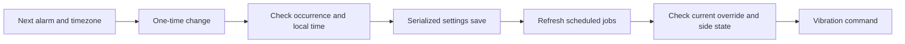

# One-time alarm controls

Tonight shows the next vibration alarm for the selected side, including its date and the Pod's timezone. Web and native iOS share the labels and actions: **Change time**, **Skip once**, and **Use routine**. A change affects one occurrence; the saved weekly routine is unchanged. The side must be on when the alarm runs. Moving an alarm later does not move the routine's power-off time, so check that the side will still be on.

The preview considers enabled routines and alarms across the whole week. An overnight routine belongs to its power-on day: Tuesday at 22:00 with a 07:00 alarm wakes on Wednesday. Afternoon routines use the same scheduler rule; there is no noon cutoff for guessing the day. Away mode pauses alarms for that side.

## Changing one occurrence

The editor keeps the displayed alarm's date and uses a 24-hour clock value in the Pod timezone. A past time is rejected, not silently moved to tomorrow. A nonexistent spring-forward time or repeated fall-back hour is rejected with an explanation; choose a time outside that transition. Ordinary weekly routines retain the installed `node-schedule` recurrence behavior, which is also used to calculate their live preview.

Each new override stores an absolute `scheduledAt`, the original `replacedAt`, its originating `scheduleDay`, and a unique `revision`. That day selects the vibration profile, even if the alarm is after midnight. The override suppresses routine alarms until two minutes after the later of the original and changed time. This preserves the existing per-side suppression window; unusually close overlapping routines inside it are also suppressed. An elapsed absolute override never becomes tomorrow's alarm after a reload.

**Skip once** preserves that suppression window. **Use routine** removes the current override and shows the next future occurrence in the weekly routine. It does not replay an alarm whose time already passed. The paused state may briefly remain after a changed alarm fires, until its suppression window ends.

## API contract

Update the Pod server, gateway and clients together. Both routes use the existing API authentication. The gateway allows these routes; it still does not expose the force/test-alarm endpoint.

- `GET /api/alarm/next?side=left` returns `side`, `timeZone`, `state`, `alarm`, `expiresAt` and `overrideRevision`. States are `scheduled`, `paused`, `none` or `away`. A scheduled occurrence includes `at`, `time`, `scheduleDay` and `source` (`routine` or `override`).
- `POST /api/alarm/override` returns the updated preview. Invalid input returns 400; an expired/stale occurrence or invalid time choice returns 409; a save failure returns 500.

Use the exact identity returned by the preview:

```json
{"side":"left","action":"time","time":"08:00","expectedAt":"2026-10-15T14:00:00.000Z"}
```

```json
{"side":"left","action":"disable","expectedAt":"2026-10-15T15:00:00.000Z"}
```

```json
{"side":"left","action":"restore","expectedExpiresAt":"2026-10-15T15:02:00.000Z","expectedRevision":"a3e87eb6-505e-4416-b82f-a545e19e07bf"}
```

The timestamps above are examples, not reusable requests. Edits bind to the occurrence shown when the editor opened. If another client changes it or the alarm time passes, cancel, refresh and review the new state. A stale editor cannot change next week's alarm. Restore checks both expiry and override revision so an old restore request cannot clear a newer edit, even when the two edits share an expiry. Legacy overrides without a revision still use their expiry identity.

Settings mutations are serialized across the general settings and alarm routes. A change arriving while jobs are being recreated requests another refresh. An override callback rechecks the saved override before execution, covering a cancellation that precedes the filesystem watcher. These are local server protections, not guarantees about device execution after a command is sent.

Legacy clock-only overrides remain readable. Legacy edits through `/api/settings` clear absolute override metadata; unrelated partial settings changes retain it. Prefer the dedicated alarm route for new clients because it validates occurrence identity and date/time semantics.



## Shortcuts and validation

The native app adds **Get next bed alarm**, **Change next bed alarm**, **Skip next bed alarm**, and **Restore bed alarm routine** to the Shortcuts action catalog. Change takes a strict `HH:mm` string in the Pod timezone, on the upcoming alarm's existing date. These actions use the saved live connection and return errors when offline. Debug demo mode blocks system actions.

Web and iOS demos simulate alarm changes independently and never contact a Pod. Automated tests cover DST, overnight and afternoon routines, stale edits, expiry, legacy settings, concurrent saves and HTTP routes. Browser and simulator checks cover changing, skipping and restoring the displayed alarm. Signed-device Siri execution, server installation, vibration and overnight reliability on the owner's Pod remain unverified. See [validation evidence](VALIDATION.md).

Sources: [node-schedule recurrence and timezone support](https://github.com/node-schedule/node-schedule), [Moment Timezone ambiguous inputs](https://momentjs.com/timezone/docs/#/using-timezones/parsing-ambiguous-inputs/), and [Apple App Intents](https://developer.apple.com/documentation/appintents/creating-your-first-app-intent).
