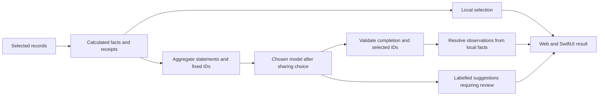

# Calculated observations and model suggestions

Coach now separates the observations calculated from your records from the suggestions written by a model. Both web and iPhone show **Calculated observations**, an expandable **How these were calculated** section, and the source of the suggestions.

Each observation has a receipt with its period, Pod timezone or check-in scope, contributing night/check-in count and calculation method. The result is a snapshot of the records used for that request; it does not automatically change when new readings arrive. Changing side/range/question/provider clears the old result, and a new request recalculates the facts. Source records are never rewritten by this flow.

## What the model can return

Before sending a request, the server builds an available-fact catalog. The model returns only:

```json
{
  "factIds": ["bed-presence", "bedtime-variation"],
  "suggestions": ["Try one small routine change, then compare another week."]
}
```

The server resolves each selected ID to its own observation text and receipt. The model cannot supply the displayed measurement, rewrite an observation, invent a fact ID, change the result title or remove the app's limitations. There must be 1–5 distinct available IDs and 1–3 nonblank suggestions, each at most 600 characters. Extra properties, duplicate IDs and unavailable facts reject the result with 502. There is no silent fallback to unstructured generation, another provider or an automatic paid retry.

**Suggestions remain generated prose.** Their meaning is not deterministically verified by ID validation. Prompts prohibit invented measurements, diagnoses, causal claims and device commands, but those instructions are not proof of compliance. The UI labels model suggestions for review. A real-model evaluation covering factual leakage into suggestions, usefulness, abstention, injection attempts, latency and cost remains required. Neither facts nor proposals control hardware.

Local calculations retain their deterministic suggestions and normal observation selection. The labelled demo also uses local calculations, including when simulating a model choice, and makes no external calls.

## Available evidence

| Fact | Availability and interpretation |
| --- | --- |
| Bed presence | Mean known presence for recent main episodes, displayed to the nearest minute; not measured sleep. |
| Bed-entry consistency | Spread of recorded bed-entry clock times, with its contributing-night count. |
| Weekly presence change | Only when both calendar periods have at least three known-presence nights. Both counts and periods are shown. |
| Heart rate, HRV, breathing | Each requires an eligible nightly average. Counts are metric-specific; the experimental estimates are not described as validated. |
| Coverage | The comparison rule and available-record counts, including sparse or empty histories. |
| Warm/cold check-ins | Reported comfort among the latest seven matching check-ins, which can span more than a week. |
| Habit associations | A difference between matched groups with at least five known-presence nights each. The observation explicitly says it is an association, not a cause. |

The catalog contains a limited-observations fact when no presence-duration or timing observation is available. A model cannot select a weekly change withheld by the [coverage rule](DATA_QUALITY.md), even if a question asks it to ignore that rule. The [episode filters](EPISODES.md) and longest-episode-per-wake-date rule remain authoritative.

## Provider contract

All adapters request structured output and independently validate the result. The provider JSON schema is static and contains no dates, personal measurements, question text or user-specific enum values. Fact availability is checked after generation. The numerical summary, aggregate coverage, aggregate fact statements, numerical journal patterns and submitted question are message content sent only after the existing per-request sharing choice. Raw episodes, sensor readings, saved journal notes and the per-date coverage inventory stay out of the payload. Expanded receipt context/calculation fields also stay local.

Current formats were checked against primary documentation on 14 October 2026:

- OpenAI Responses: `text.format` with `json_schema`, a schema name and `strict: true`; request storage remains disabled. [Structured Outputs](https://developers.openai.com/api/docs/guides/structured-outputs?api-mode=responses).
- Anthropic Messages: `output_config.format` with `json_schema`. Personal values are kept out of the cached schema. [Structured outputs](https://platform.claude.com/docs/en/build-with-claude/structured-outputs).
- Gemini's existing `generateContent` adapter: `generationConfig.responseFormat.text` with JSON MIME type and schema. This retains the existing endpoint; the newer Interactions API is a separate migration. [Generate Content structured outputs](https://ai.google.dev/gemini-api/docs/generate-content/structured-output?hl=en).
- Ollama: a JSON schema in `format`, with non-streaming generation. [Structured outputs](https://docs.ollama.com/capabilities/structured-outputs), [chat response fields](https://docs.ollama.com/api/chat).

The parser also requires completion: OpenAI `completed`, Anthropic `end_turn`, Gemini `STOP`, and Ollama `done: true` with `stop` when a reason is supplied. Refusals, truncation, blocked/empty output, malformed envelopes and oversized bodies fail. A syntactically valid selection inside an interrupted response is not published. Gemini thought text is excluded from the final output parser. Errors do not echo provider response content.

Configured overrides must support the adapter's structured-output format. Account/model compatibility and actual provider quality have not been proved by mock tests. [Setup](PLATFORM_SETUP.md) retains the default models and explicit choice of provider.

## Response compatibility

The public coaching response retains `headline`, `observations`, `suggestions`, `limitations`, `provider`, `model` and `generatedAt`. It adds:

```text
grounding: {
  version: 1,
  suggestions: "rules" | "model",
  facts: [{ id, title, observation, context, sample, calculation }]
}
```

The fact order matches `observations`. Older clients can ignore the addition. New clients can still read older responses and show an update instruction instead of claiming those observations have calculation receipts. This is an additive client API; the internal model response contract deliberately changes. There are no new gateway routes.



## Verification

`server/tests/coaching-facts.test.ts` checks receipts, sparse boundaries, missing metrics, check-in scope, noncausal associations, duplicate/invented IDs, attempted observation rewrites, refusals/truncation, malformed/oversized bodies, oversized-stream cancellation and no retries. `ai-auth.test.ts` captures the exact mocked request schema and aggregate payload for each provider, then checks the resolved output. Native tests compare receipts across the seven shared calendar/missing-data cases and the normal 7/30/90-day demo, and preserve older-response decoding. No real provider, owner data or hardware is used by these tests.
