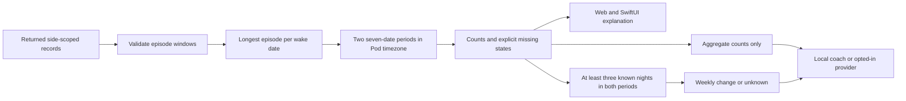

# Analytics coverage

**Sleep → Understand the data** shows what supports a weekly comparison on web and native iPhone. It describes the records returned for the selected side and history range. It is not a sensor-uptime monitor or a confidence score.

The recent period contains seven calendar dates ending on the latest returned wake date in the Pod timezone. The previous period contains the preceding seven dates. These periods may be historical. A 7-day request normally cannot supply a complete preceding period; choose 30 or 90 days to include earlier records. The database query is still bounded by episode start time, so an episode starting outside that query window is not returned even if it ends inside it.

Each period lists recorded nights and nights with known presence, heart rate, HRV and breathing. **Review the dates** distinguishes:

| State | Meaning |
| --- | --- |
| Known presence | The selected main episode has a presence duration. A measured zero remains a value. |
| Presence unknown | An episode exists, but its presence intervals do not yield a usable duration. |
| No record returned | No usable main episode was returned for this date in this request. This does not establish a hardware fault, absence from bed or no sleep. |

The longest episode per wake date supplies the nightly summary. A shorter episode with good readings cannot silently fill gaps in that main episode. Each vital count requires an eligible average for that metric; one valid reading is enough to count a night. Counts therefore describe availability, not completeness throughout a night or accuracy. Existing presence and plausible-value filters still apply; see [recorded episodes](EPISODES.md).

## Weekly comparison rule

`summary.weeklyChangeMinutes` is null unless **both periods contain at least three nights with known presence**. Missing/unknown nights are not filled with zeroes. Once that threshold is reached, the difference remains a descriptive difference between the two available-record averages. Three nights is an application display rule, not a validated statistical or medical confidence threshold. It does not establish improved sleep quality or causation.

Invalid timestamps, nonpositive windows and windows over 72 elapsed hours are excluded consistently from the overview and episode details. The report counts those excluded episodes. Source records and vital readings are not modified. An empty usable range has no invented calendar dates; both periods are null.

## API and compatibility

`GET /api/analytics?side=left&days=30` includes the additive `quality.coverage` object:

- `version: 1`, `minimumNights: 3`, `comparisonAvailable`, `comparisonReason`, `excludedEpisodes` and `scopeNote`.
- `recent` and `previous`: null, or `from`, `through`, seven `days: [{date, status}]` and five availability counts.
- Status values: `known`, `unknown`, `not_returned`. Counts: `recordedNights`, `presenceNights`, `heartRateNights`, `hrvNights`, `respiratoryRateNights`.

The clients use the server report for live data. Older responses still decode, and the card asks for a server update when coverage is absent. The stricter weekly-change rule requires the updated server; an old server's existing summary remains its own calculation. No gateway route change is needed. Side/range changes reset the disclosures, and record corrections/deletions recompute coverage along with the existing summary.

## Coach and data sharing

Local coaching names the recorded period's end date and includes the coverage explanation. A sparse comparison does not produce a weekly-change observation. An opted-in model request receives the existing numerical summary (including its end date), aggregate coverage counts and the existing habit-pattern/question payload. Per-date coverage inventories, raw episodes, readings and saved notes are not added to model requests.

Provider instructions require period-qualified wording and prohibit inferring a weekly change when it is unavailable. Mock adapter tests check request content; they do not establish that a real model follows those instructions. Generated statements still require model-quality evaluation before stronger reliability claims.



## Reproducible checks

From `server/`:

```sh
node --import tsx scripts/generateSleepDemo.ts --check
node --import tsx scripts/generateCoverageCases.ts --check
node --import tsx --test tests/coverage.test.ts tests/analytics.test.ts tests/ai-auth.test.ts
```

Omit `--check` to regenerate a fixture after an intentional contract change. `shared/fixtures/coverage-cases.json` is bundled only with the native test target. It covers empty, sparse, threshold, unknown-main-episode, spring/fall DST and leap-day examples. Native tests recompute the server expectations, while server assertions separately check expected dates, counts and withholding behavior. The ordinary synthetic demo fixture contains the same report used by both clients.

See [validation evidence](VALIDATION.md). No hardware, clinical accuracy, real model quality or live deployment is established by these fixtures.
