# Unified sleep delivery status

Verified 26 October 2026. Source integration, staged runtime checks and physical
acceptance are recorded separately. This checkpoint does not enable a controller,
home automation or personal comfort policy.

## GitHub reconciliation

The GitHub API reported **100 merged PRs, zero open PRs and zero closed-but-unmerged
PRs** across the three owner repositories before this documentation update. Every
one of those merge commits was independently verified as an ancestor of its
repository's `main`, including Free Sleep PRs originally targeting an intermediate
installation branch.

| Repository | Verified PRs | Audited main revision |
| --- | --- | --- |
| [Free Sleep](https://github.com/lucaandrea/free-sleep/pulls?q=is%3Apr+is%3Aopen) | #1–#16 merged | `96e8a614956980d60a064c5d3816ef4f4b838989` |
| [SleepyPod Core](https://github.com/lucaandrea/sleepypod-core/pulls?q=is%3Apr+is%3Aopen) | #1–#45 merged | `c105621bf862b022c14aec2c49604a567aa96420` |
| [SleepyPod iOS](https://github.com/lucaandrea/sleepypod-ios/pulls?q=is%3Apr+is%3Aopen) | #1–#39 merged | `aa15b367e60d0e68142b78f8d3e120812de82e3d` |

Eleven remaining `lucas-assistant/` remote branches exactly matched merged PR
heads: ten in Free Sleep and one in Core. They were removed with expected-head
leases after ancestry verification. No branch contained additional unmerged work.
Existing worktrees and unrelated upstream branches were retained. The Core fork's
default branch now points to `main`; its previous default was the older `dev`.

All latest Core PR #45 and native PR #39 checks passed. Core's cleanup also ran
the mandatory local hook: TypeScript, ESLint, both Drizzle checks, 21 migration
tests and 125 deployment tests. No application source changed during this audit.

## Current implementation and staged runtime

The current Core source includes qualified telemetry and mechanical artifact
handling, the shared temperature controller, personal comfort Preview, reviewed
night reports, owner qualification and bounded activation, room-sensor adapters,
MQTT command receipts, disabled Home Assistant templates, preserved imported
history, and current migration/recovery tooling.

The canonical owner flow is documented in
[Owner qualification and thermal activation](https://github.com/lucaandrea/sleepypod-core/blob/c105621bf862b022c14aec2c49604a567aa96420/docs/COMFORT_OWNER_ACTIVATION.md).
Its implemented Active temperature path requires the actual owner qualification
and seven matching reviewed Preview nights. The ordinary legacy comfort mode
endpoint cannot activate it. Active bedtime shifting remains unavailable.

The application package from `41d6f9389bffb6448d06f49584a810cabfbe97a1` is staged
on the Pod. All 55,200 application/runtime files and links matched the manifests.
Node 24.22.1, in-memory SQLite and image encoding passed as the service account on
the actual Pod. Those probes did not start the application or send hardware
commands. PR #45 adds preparation tooling; its tested tree matches the merged
`c105621` source and is staged separately.

The last directly verified live state remained **Free Sleep active and enabled,
Core stopped and disabled**. Installed inactive Core/maintenance units still
target the earlier `f0c40fa` release. The new `41d6f93` plan is prepared separately;
starting an existing unit does not select that new release. At this audit the Mac
could not reach the saved Pod, Home Assistant, Homebridge or private Lenovo
addresses. This establishes a missing deployment connection, not a Pod failure.

## Data review and next deployment steps

An online backup was retained off-host and imported into a separate candidate.
All three databases passed integrity and foreign-key checks; exact migration
ledgers contain 45 controller and 33 biometric migrations. Imported history stays
source-labelled. The candidate contains no fabricated qualification or Preview
evidence, and personal comfort, general Autopilot, HomeKit and MQTT remain off.

The review retains 47 items: 40 out-of-window temperature targets disabled, five
alarm warm-up/hold differences, and two capacitance baselines pending physical
qualification. The private review contains the actual routine clocks and source
hashes. An online backup is not a final quiesced cutover capture.

```mermaid
flowchart LR
  Source[Merged source and verified package] --> Access[Working private connection]
  Access --> Attendance[Fresh attended idle window]
  Attendance --> Capture[Quiesced capture and retained-service recovery]
  Capture --> Review[Review migration and install exact inactive plan]
  Review --> Trial[Bounded Core trial and observed rollback]
  Trial --> Hardware[Qualify controls and integrations]
  Hardware --> Preview[Seven real reviewed Preview nights]
  Preview --> Activation[Review bounded personal activation]
```

Follow [quiesced preparation](https://github.com/lucaandrea/sleepypod-core/blob/c105621bf862b022c14aec2c49604a567aa96420/docs/QUIESCED_IMPORT.md)
and [controller handoff](https://github.com/lucaandrea/sleepypod-core/blob/c105621bf862b022c14aec2c49604a567aa96420/docs/CONTROLLER_HANDOFF.md)
with a fresh owner-confirmed idle window. Preserve the original installation,
dedicated SSH and off-host recovery artifacts. Review all translations before
promoting the complete candidate and replacing inactive service definitions.
Do not reuse the older trial receipt as evidence for this runtime.

Thermal operation, empty/occupied presence, base movement/Stop, vibration/cancel,
restarts, home accessories and seven real Preview nights still need observation.
House templates remain disabled until individually qualified. No serial wiring
is required while the dedicated network recovery connection works.

## Native and bedside delivery

The independently maintained native app is
[sleepypod-ios](https://github.com/lucaandrea/sleepypod-ios), using the owner's
subsequently requested original SleepyPod presentation. Its current source
includes the Core #44 owner qualification/activation/recovery flow. The earlier
native implementation here is retained as a feature/service source.

The native owner is separately handling signing, App Store Connect/TestFlight and
the Waveshare client. A signed candidate is not proof of App Store processing or
tester assignment; consult that repository's release evidence for the exact
distributed build. Physical client provisioning requires a verified activated
Core origin and protected connection credentials. Neither a Home Assistant URL
nor a deployment-only diagnostic credential is a client handoff.

See [the historical client contract and trial record](CLIENT_INTEGRATION_HANDOFF.md)
for earlier integration details. None of the software or packaging results above
establish physical performance or improved sleep outcomes.
