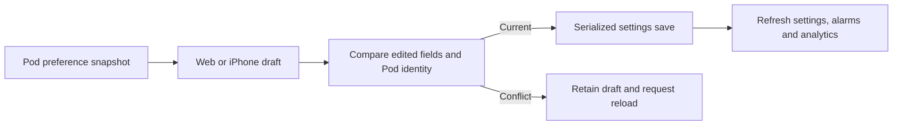

# Device preferences and system health

Web Settings and native Settings now link to the same everyday device preferences: timezone, temperature units, side names, per-side Away mode, daily priming time and daily reboot. Both use Time & temperature, Side settings and Daily care sections. Edits remain a draft until Save device settings; Reset draft restores the last loaded snapshot. Reload saved settings discards the local draft and fetches current values.

Changing the timezone changes the wall-clock schedule for routines and daily tasks. Away mode pauses the corresponding side's scheduled controls. Daily reboot currently depends on daily priming being enabled and runs one hour before it. Priming at 00:xx schedules the reboot at 23:xx; the clock calculation wraps across midnight instead of passing hour −1 to node-schedule. The actual timezone and recurrence behavior is covered by a scheduling test. This does not establish physical reboot or priming behavior.

## Shared write contract

Update the server and gateway alongside either client. Older versions do not expose this additive endpoint; clients do not fall back to replacing the entire settings object.

- `GET /api/settings/preferences` returns `{ podID, timeZones, preferences }`.
- `POST /api/settings/preferences` accepts `{ podID, expected, preferences }`, where `expected` is the last loaded preference snapshot and `preferences` is the edited draft.
- Both snapshots contain only `timeZone`, `temperatureFormat`, `left/right { name, awayMode }`, `primePodDaily { enabled, time }` and `rebootDaily`. Extra keys are rejected. Names are trimmed, nonblank and at most 20 UTF-16 code units; the clock is strict `HH:mm`.
- The server serializes the write with existing settings operations. It compares only edited fields against their original values, keeps concurrent changes to untouched fields, and validates every edit before mutating the persisted draft. A changed Pod or conflicting field returns HTTP 409 with no partial write.
- Editing daily-care timing also requires the original timezone to remain current. A timezone change elsewhere therefore forces review of a stale daily-care draft.
- Pod identity, tap behavior, alarm overrides, routines and other advanced settings are preserved. Storage failures do not report success. The iPhone also ignores responses invalidated by connection changes.

## Service health

`GET /api/serverStatus` supplies both System health pages. They show the service name, status, description, message and reported timestamp, plus when the client last received a snapshot. The pages refresh every five seconds while active and offer manual refresh. A failed request displays an error; an already received snapshot remains labelled as the last successful result. Native polling stops when the screen's task is cancelled or the app becomes inactive.

These are reported process states, not an independent measurement of sensor accuracy, overnight reliability or physical hardware operation. Web-only maintenance, LED, service-management and log screens remain reachable separately. Native Health and Apple Home permission flows retain their platform-specific UI.

## Demo and verification

`shared/fixtures/device-demo.json` supplies matching initial preference and service-health data to both clients. Edits stay in memory; restarting the native demo or reloading the browser restores the fixture. No settings request reaches a real Pod in demo mode. Timezone changes also update demo analytics, journal date context and alarm labels. An existing one-time alarm keeps its absolute instant when its displayed timezone changes.

See [validation evidence](VALIDATION.md) for automated checks and browser/simulator captures. The owner’s stock Pod, actual priming/reboots, signed iPhone integrations and deployment remain separate validation work.
