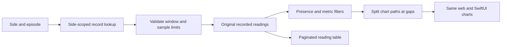

# Recorded episodes and vitals

Open **Sleep → Browse episodes** on web or iPhone. The same card lists every recorded episode in the selected history range, including shorter episodes that do not contribute another night to the overview. The web's **Data → Vitals** page now opens this browser directly. Choose **Edit record** or **Delete record** below the episode selector on either platform. The older web record-management page uses the same editor.

The selector uses the episode's wake date. The presence bar and charts label both the start and end dates in the Pod timezone. Recorded-reading rows include the timezone abbreviation, so repeated daylight-saving hours remain distinguishable. A selected episode shows its window, detected presence duration, recorded exits and number of original vital records. Changing side or range resets the detail selection; native analytics are also cleared before loading a different side or range.

## What the charts mean

Heart rate, HRV and breathing share one chart layout. Each shows its eligible-reading count, mean and range. These values use the same presence intervals and plausible-value thresholds as the existing overview:

| Metric | Values included in charts |
| --- | --- |
| Heart rate | 25–220 bpm |
| HRV estimate | 1–300 ms |
| Breathing estimate | 4–50 per minute |

These are data-filtering bounds, not diagnostic reference ranges. The HRV and breathing estimates remain experimental. Presence does not establish measured sleep, sleep stages or sleep quality.

Intervals are clipped to the episode, sorted and merged before calculating presence. Chart paths break at invalid or missing values, outside detected presence, between separate presence intervals, and across reporting gaps over 15 minutes. A single eligible point is shown as a dot. No interpolation or downsampling fills those gaps. Missing/corrupt presence intervals leave the presence duration and eligible metric values unknown; original vital records remain available.

**Show recorded readings** opens a table of original values with 20 rows per page. It retains excluded values, marks presence as Detected, Outside or Unknown, and displays missing values as a dash. Values are formatted to one decimal for display; the API retains original numeric precision. Horizontal scrolling keeps the table readable on a phone.

## API and limits

`GET /api/analytics/episodes/:id?side=left|right` reads the episode. A positive integer ID and explicit bed side are required. The lookup and subsequent vital query both use that side and the selected record's time boundaries. The gateway permits GET, PUT and DELETE for this exact route shape; other methods remain excluded.

- 400: missing/invalid side or ID.
- 404: no matching record for that side, including a removed record.
- 422: invalid timestamps, a window over 72 hours, or more than 2,880 recorded vital samples.

The database read is capped at 2,881 samples to detect overflow. The endpoint rejects an excessive result rather than silently truncating it. The response includes the episode summary, relative presence intervals, original samples, pre-split plot segments and interpretation notes. There are no hardware commands or model-provider calls in this flow. Server, gateway and clients must be updated together to use the endpoint.



## Correct or remove a record

Both clients show the selected side, Pod timezone and full start/end dates. Date summaries include the UTC offset to distinguish repeated daylight-saving hours. The web uses outlined date/time fields; iOS uses native date/time pickers in a sheet. Changes are drafts until **Save changes**. Invalid or unchanged windows cannot be saved, and controls/dismissal are disabled while the request is pending. Deletion has a separate confirmation and preserves the original vital readings.

Edits must end after their start and span no more than 72 elapsed hours. They update only the record window, its duration and the count of complete recorded exits inside it. Original presence/absence intervals and vital readings remain intact, so extending a window does not fabricate presence or measurements. Charts clip those original intervals to the corrected window. Nightly trends remain ordered by wake date, including corrections that span multiple dates. A later full biometric reanalysis may recreate records; deletion is not a permanent exclusion rule for future analysis.

The current clients use these guarded operations:

- `PUT /api/analytics/episodes/:id`: JSON contains `side`, `expected: { entered_bed_at, left_bed_at }` and the two new ISO timestamps.
- `DELETE /api/analytics/episodes/:id`: JSON contains `side` and the same `expected` original window.
- Success returns 204. Invalid input returns 400; a missing or wrong-side edit returns 404; stale/removed records or a conflicting start time return 409. Corrupt recorded-exit intervals prevent an edit with 422. Deletion is deliberately not silently idempotent: an absent record requires a refresh.

The database compares the original side/window when writing, so simultaneous edits cannot silently overwrite one another. Exit calculations also compare the original absence data. Client dialogs retain the exact selected snapshot; native edits additionally check that the connection has not changed. Neither client retries writes automatically. After a success, clients refresh history and episode details; cancelled or superseded native reads cannot restore pre-edit data.

**Update the server, gateway, web app and iPhone app together.** Using the analytics route ensures an older server or gateway rejects an unsupported mutation instead of invoking its old, unguarded record editor. The legacy `/api/metrics/sleep/:id` PUT/DELETE paths remain guarded aliases on the updated server and now require the same identity body; older callers receive a validation error. They also return 204 rather than an updated record.

Apple Health exports are separate from the Pod database. A subsequent Health sync reconciles exports only within its requested window and linked personal side. This edit does not write to HealthKit immediately. Older exports outside that window need an appropriate sync or management in Apple Health; deletion here is not a promise that all historical Health samples have been removed.

## Demo and verification

Both clients read `shared/fixtures/sleep-demo.json`. It contains 14 synthetic main nights, one short episode, missing readings, an outlier, a presence gap and a reporting gap. The 7-day sample view contains seven main nights plus the short episode; 30/90-day views show all available sample records. Dates are fixed for reproducible screenshots and are explicitly demo data. The fixture includes original synthetic records and readings. Both previews hold edits in memory, isolate the two sides, and recompute charts, summaries and sample coaching; reload/relaunch restores the fixture.

Regenerate or check the fixture from `server/`:

```sh
node --import tsx scripts/generateSleepDemo.ts
node --import tsx scripts/generateSleepDemo.ts --check
```

After building a web demo, use `npm run preview:demo`. `preview:hosted` explicitly serves the hosted output; plain Vite preview follows the configured build directory and does not imply demo mode.

Server tests cover filtering and raw-value preservation, unknown presence, record bounds, response size for the maximum tested sample set, side isolation and HTTP errors. Native tests decode the same fixture, distinguish repeated DST hours and check side/range invalidation. Browser and simulator captures are listed in [validation evidence](VALIDATION.md). Actual Pod readings, sensor accuracy and older iOS runtimes remain unverified.
