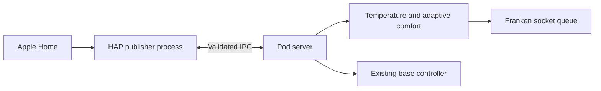
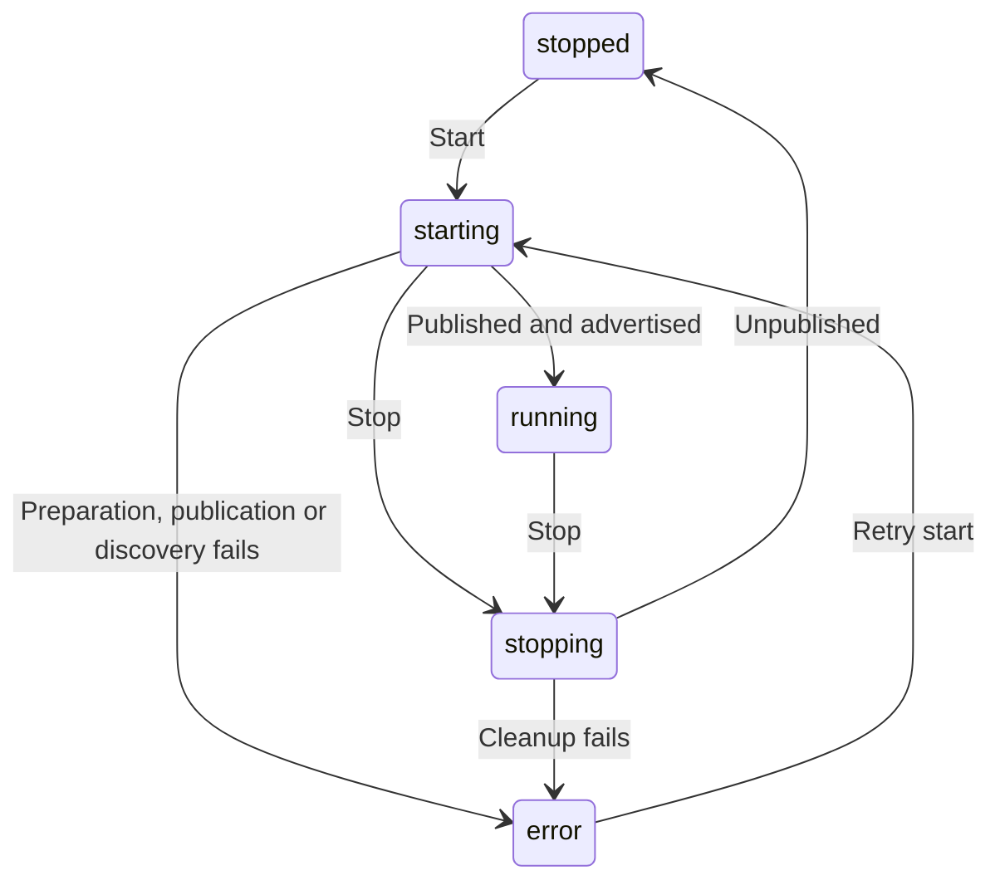

# Apple Home bridge reliability

Implemented and checked locally on 2026-10-14. The optional bridge remains on the Pod, enabled with `HOMEKIT_ENABLED=true`. Replit does not publish a HomeKit accessory on the home network. The existing web and iPhone pairing instructions remain compatible with the status response.

The HAP network publisher now runs in a dedicated child process. The main server keeps ownership of Franken, the base connection, adaptive comfort, schedules and analytics. A fatal HAP socket error terminates the publisher and produces an error in Settings; it does not trigger the main server's fatal-error shutdown handler.

## Startup, discovery and shutdown

`GET /api/integrations/homekit` retains `enabled`, `running`, `pairingCode`, `setupURI` and `error`, and adds `state`:

| State | Meaning |
| --- | --- |
| `disabled` | The local bridge is not enabled. No identity storage is opened. |
| `stopped` | Enabled, but not currently published. |
| `starting` | Preparing the bridge or waiting for discovery. Pairing details remain hidden. |
| `running` | Publication completed and HAP emitted its mDNS `advertised` event. This does not establish Apple Home pairing or Pod reachability. |
| `stopping` | New commands are rejected while publication and cleanup finish. |
| `error` | Preparation, publication, discovery or cleanup failed. The existing `error` field explains the failure. |

HAP's `publish()` promise can resolve before the accessory is discoverable. The controller waits for both publication and the `advertised` event before returning `running: true` and the pairing details. Discovery has a thirty-second deadline. The TCP port must be an integer from 1 to 65535; the default remains 51826.

Starts and stops are serialized. Repeated starts share the current operation. Stopping cancels the discovery wait, disables accessory handlers and clears polling immediately, then waits for any publication already in progress before unpublishing. A requested restart creates fresh HAP objects only after cleanup. Late readings cannot update the retired accessories. Cleanup uses `unpublish()`, never the destructive pairing-data cleanup API.

The bridge controller's lifecycle methods are used by the server. This change does not add a remote start/stop API. A failed startup is surfaced in Settings; configuration changes still require restarting the server.

The parent supervises process startup with a forty-five-second deadline; discovery inside the child retains its thirty-second deadline. Shutdown first requests graceful unpublication, then escalates to SIGTERM and SIGKILL for that owned child within a five-second window. Process exit is authoritative, with `close` also handling failed launches. If exit cannot be confirmed, the process handle is retained, an error remains visible and a replacement is not started. A worker also exits when its parent IPC connection disappears. Crashed publishers are not restarted automatically, and commands are never replayed after a crash. An explicit lifecycle restart waits for the old publisher to exit and reuses the same pairing directory.

The launcher forwards only `PATH`, `LANG`, `LC_ALL`, `TZ` and `NODE_ENV`. It supplies its own Node launch arguments, excluding parent debug/test/instrumentation flags and provider credentials. Production uses the compiled worker; source development uses the installed `tsx` loader. Publisher stdout/stderr are not forwarded to the server log. Known fatal socket codes receive a concise status message; other failures receive a generic error. This is process crash containment, not an operating-system sandbox or a resource-limit guarantee.

`HOMEKIT_BIND` optionally selects an IP address for HAP's advertisement selection. **It does not bind the TCP listener exclusively to that address.** In installed HAP 0.14.3, an IPv4 selection still uses `0.0.0.0`, and an IPv6 selection uses `::` for TCP. Use network/firewall configuration for listener isolation. The default remains HAP's normal local-network discovery behavior.

## Pairing identity

The existing `DATA_FOLDER/homekit/identity.json`, HAP pairing directory, bridge UUID derivation, accessory UUID derivations, names and service order are retained. A missing identity is written to a private temporary file and atomically linked into place without overwriting an existing identity. Concurrent initializers read the same completed file. New identity files use mode `0600`; the directory is created with mode `0700`.

Corrupt existing identity data fails with recovery guidance. It is never regenerated automatically. HAP storage is configured once per process so a controller restart can reuse the initialized storage singleton. Back up the entire HomeKit directory; this implementation does not replace backups or establish power-loss durability for all of HAP's own files. Real paired-device upgrade persistence remains a device acceptance check.

## Temperature and actions

The two thermostats retain their existing Celsius wire format, Fahrenheit display preference and half-degree target control. Target requests at the edge of that range are clamped to the Pod's 55–110°F limits. Invalid values are rejected before reaching the hardware. Each thermostat routes its request through the existing `updateDeviceStatus` coordinator, including its Away-mode and manual-control behavior.

Status reads share an in-flight request and cache successful readings for five seconds using a monotonic clock. Writes invalidate both sides before and after dispatch, even if a command partially fails. A read that began before a write cannot repopulate the cache or publish stale telemetry. Reads during a write return HomeKit's busy status. Offline reads return a communication error. Polling runs every ten seconds, does not overlap, and updates current/target temperature plus power and estimated heating/cooling demand.

The Pod status does not expose compressor activity. HomeKit's current heating/cooling state is inferred from power and the difference between measured and target temperatures; equal temperatures or power off report idle. It is not a measurement of heater or cooler operation.

Preset, Stop and Prime switches are momentary actions. Duplicate requests on the same switch share its pending operation. Stop has its own handler and can run while a movement request is pending. A failed action returns a HomeKit error; successful acknowledgements do not prove physical movement. Switches reset after an action settles. Shutdown clears reset timers and prevents queued, undispatched actions from reaching hardware. It cannot retract a physical command already sent.

IPC accepts only status reads, one-side temperature or power updates, priming, bounded base positions and Stop. It does not expose arbitrary Franken commands, settings changes, filesystem operations or base connection setup. Requests have increasing identifiers and an eight-second deadline. Both sides validate the protocol, reject repeated/expired requests and bound outstanding work to 32 ordinary requests plus one reserved Stop slot. A child timeout sends cancellation; the parent also enforces its own timeout. Disconnect or shutdown invalidates every pending request.

Cancellation is rechecked at temperature coordination, after loading comfort state, and inside the actual Franken/base write queues. A cancelled request that was waiting cannot later pause adaptive comfort, dispatch a temperature/prime command or send the delayed feet packet of a base movement. Completed effects are not rolled back: a head packet already sent may still move the base, and an accepted manual change may already have affected comfort state. The separate web/iPhone Stop action continues to use the main server's base controller.

## Evidence and remaining work

The original seventeen tests exercise actual HAP accessories and characteristics with injected hardware, replacing publication with a bridge that never opens a socket. Twelve additional process tests exercise real child processes, real HAP handlers across IPC, crash containment, deadlines, message validation, request bounds, independent Stop, cancellation, orphan cleanup, forced termination, explicit restart, preserved identities and the default launcher. Four further tests cover the actual Franken queue with an in-memory socket, cancelled base packets and cancelled comfort coordination. All 84 server tests, TypeScript compilation and server lint passed; lint retains 21 pre-existing warnings. The compiled supervisor/worker also passed a startup-failure/clean-exit smoke check using intentionally corrupt temporary identity data, without publication or hardware access.

The final port-conflict test occupies the wildcard TCP address before starting the actual HAP publisher, with loopback advertisement selection. HAP exits with `EADDRINUSE` before advertisement, the parent HTTP probe still responds, and no hardware requests are dispatched. During investigation, an initial probe occupied only a loopback listener; on this macOS host that did not conflict with HAP's wildcard listener. That temporary test publisher reached its advertised state with loopback selection before cleanup. Only simulated dispatch was available, no pairing was attempted by this work, and that process and temporary identity were removed. The corrected automated test checks exclusive port occupancy and stops immediately if that precondition is not met.

No Apple Home account, Home inventory, owner pairing directory, Pod or physical base was accessed. Actual owner-network discovery, pairing, reboot persistence, home-hub access, Wi-Fi loss, real commands, embedded memory use and installed-firmware compatibility remain unverified.

The installed `hap-nodejs` 0.14.3 implementation emits some TCP errors on an internal socket rather than rejecting `publish()`. The process boundary now contains that failure, as verified with a real occupied port. It does not fix the underlying network condition: correct the configuration and restart the server to retry. An advertisement timeout reports absent discovery but cannot prove why the network failed. Other network failures and operation on the embedded Pod still require qualification.

Primary references, checked 2026-10-14: [HAP accessory lifecycle and stable identity](https://developers.homebridge.io/HAP-NodeJS/classes/Accessory.html), [HAP listening and advertised events](https://developers.homebridge.io/HAP-NodeJS/enums/AccessoryEventTypes.html). Lifecycle, socket-error and storage-singleton behavior were additionally checked against the installed library source. See [Apple integrations](APPLE_INTEGRATIONS.md) and [platform setup](PLATFORM_SETUP.md) for owner setup and device acceptance.

Process references: [Node child-process lifecycle and IPC](https://nodejs.org/api/child_process.html), [fatal-error monitoring without suppressing termination](https://nodejs.org/api/process.html#event-uncaughtexceptionmonitor). The HAP address-selection behavior was verified in the installed `Accessory.parseBindOption` source and the local failure experiment described above.
