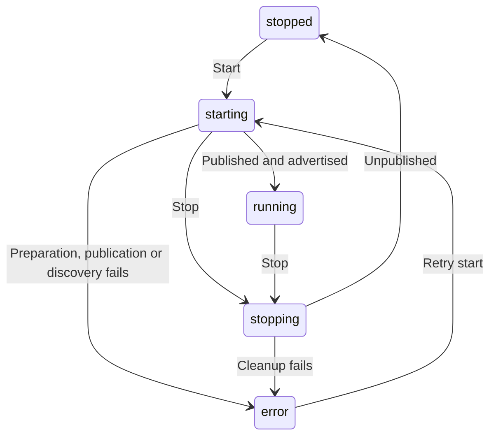

# Apple Home bridge reliability

Implemented and checked locally on 2026-10-14. The optional bridge remains on the Pod, enabled with `HOMEKIT_ENABLED=true`. Replit does not publish a HomeKit accessory on the home network. The existing web and iPhone pairing instructions remain compatible with the status response.

## Startup, discovery and shutdown

`GET /api/integrations/homekit` retains `enabled`, `running`, `pairingCode`, `setupURI` and `error`, and adds `state`:

| State | Meaning |
| --- | --- |
| `disabled` | The local bridge is not enabled. No identity storage is opened. |
| `stopped` | Enabled, but not currently published. |
| `starting` | Preparing the bridge or waiting for discovery. Pairing details remain hidden. |
| `running` | Publication completed and HAP emitted its mDNS `advertised` event. This does not establish Apple Home pairing or Pod reachability. |
| `stopping` | New commands are rejected while publication and cleanup finish. |
| `error` | Preparation, publication, discovery or cleanup failed. The existing `error` field explains the failure. |

HAP's `publish()` promise can resolve before the accessory is discoverable. The controller waits for both publication and the `advertised` event before returning `running: true` and the pairing details. Discovery has a thirty-second deadline. The TCP port must be an integer from 1 to 65535; the default remains 51826.

Starts and stops are serialized. Repeated starts share the current operation. Stopping cancels the discovery wait, disables accessory handlers and clears polling immediately, then waits for any publication already in progress before unpublishing. A requested restart creates fresh HAP objects only after cleanup. Late readings cannot update the retired accessories. Cleanup uses `unpublish()`, never the destructive pairing-data cleanup API.

The bridge controller's lifecycle methods are used by the server. This change does not add a remote start/stop API. A failed startup is surfaced in Settings; configuration changes still require restarting the server.

## Pairing identity

The existing `DATA_FOLDER/homekit/identity.json`, HAP pairing directory, bridge UUID derivation, accessory UUID derivations, names and service order are retained. A missing identity is written to a private temporary file and atomically linked into place without overwriting an existing identity. Concurrent initializers read the same completed file. New identity files use mode `0600`; the directory is created with mode `0700`.

Corrupt existing identity data fails with recovery guidance. It is never regenerated automatically. HAP storage is configured once per process so a controller restart can reuse the initialized storage singleton. Back up the entire HomeKit directory; this implementation does not replace backups or establish power-loss durability for all of HAP's own files. Real paired-device upgrade persistence remains a device acceptance check.

## Temperature and actions

The two thermostats retain their existing Celsius wire format, Fahrenheit display preference and half-degree target control. Target requests at the edge of that range are clamped to the Pod's 55–110°F limits. Invalid values are rejected before reaching the hardware. Each thermostat routes its request through the existing `updateDeviceStatus` coordinator, including its Away-mode and manual-control behavior.

Status reads share an in-flight request and cache successful readings for five seconds using a monotonic clock. Writes invalidate both sides before and after dispatch, even if a command partially fails. A read that began before a write cannot repopulate the cache or publish stale telemetry. Reads during a write return HomeKit's busy status. Offline reads return a communication error. Polling runs every ten seconds, does not overlap, and updates current/target temperature plus power and estimated heating/cooling demand.

The Pod status does not expose compressor activity. HomeKit's current heating/cooling state is inferred from power and the difference between measured and target temperatures; equal temperatures or power off report idle. It is not a measurement of heater or cooler operation.

Preset, Stop and Prime switches are momentary actions. Duplicate requests on the same switch share its pending operation. Stop has its own handler and can run while a movement request is pending. A failed action returns a HomeKit error; successful acknowledgements do not prove physical movement. Switches reset after an action settles. Shutdown clears reset timers and prevents queued, undispatched actions from reaching hardware. It cannot retract a physical command already sent.

## Evidence and remaining work

Seventeen new tests exercise actual HAP accessories and characteristics with injected hardware. Publication is replaced by a test bridge that never opens a socket or advertises. Identity tests use temporary directories. They cover startup readiness and failures, concurrent identity creation, restart storage, command validation/conversion, side routing, stale reads, partial failures, duplicate actions, independent Stop, retries, shutdown and polling cleanup. All 68 server tests, TypeScript compilation and server lint passed; lint retains 21 pre-existing warnings.

No Apple Home account, Home inventory, owner pairing directory, Pod or physical base was accessed. Actual mDNS discovery, pairing, reboot persistence, home-hub access, Wi-Fi loss, real commands and installed-firmware compatibility remain unverified.

The installed `hap-nodejs` 0.14.3 implementation also has a reliability limit: some TCP listener errors are emitted by an internal socket rather than rejected by `publish()` or exposed through the public accessory API. These tests do not establish recovery from an occupied port or other fatal socket error; an unhandled library socket error can terminate the server. Use a dedicated available port. Isolating the publisher from the Pod control process is follow-up work, alongside real network/device qualification. An advertisement timeout reports absent discovery but cannot prove why the network failed.

Primary references, checked 2026-10-14: [HAP accessory lifecycle and stable identity](https://developers.homebridge.io/HAP-NodeJS/classes/Accessory.html), [HAP listening and advertised events](https://developers.homebridge.io/HAP-NodeJS/enums/AccessoryEventTypes.html). Lifecycle, socket-error and storage-singleton behavior were additionally checked against the installed library source. See [Apple integrations](APPLE_INTEGRATIONS.md) and [platform setup](PLATFORM_SETUP.md) for owner setup and device acceptance.
