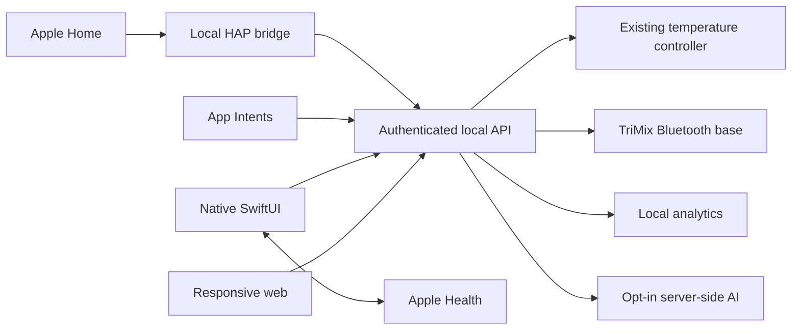

# Free Sleep platform work

Source implementation and local validation: 2026-10-13. See [setup and migration](PLATFORM_SETUP.md) and [validation evidence](VALIDATION.md).

Requested 2026-10-13. The user's Pod 4 Ultra is still on stock software; subscription renewal is cancelled with approximately ten days remaining. Do not treat local simulation as a hardware qualification or modify the stock Pod without a migration handoff.

## Delivery checklist

- [x] Research and implement local TriMix base transport, position reporting, presets and stop.
- [x] Add deterministic analytics with data-quality and provenance reporting.
- [x] Add opt-in AI coaching through server-side OpenAI, Gemini, Anthropic and local Ollama adapters.
- [x] Apply a shared warm cream/orange design to responsive web and native SwiftUI apps.
- [x] Add native HealthKit sync and App Intents.
- [x] Add a persistent local Apple Home bridge.
- [x] Prepare authenticated remote-web deployment for Replit.
- [x] Run TypeScript/lint/tests, browser checks, iOS build and simulator checks.
- [x] Document installation, validation boundaries and copyable commit title/description.
- [x] Add opt-in feedback-based adaptive comfort, preview mode, persistent manual pauses, presence heartbeat and matching controls.
- [x] Add independent personal Health-side binding, cancellable reconciliation, opt-in background refresh and sixteen Shortcuts actions; see [Apple integrations](APPLE_INTEGRATIONS.md).
- [x] Generate shared design tokens for web and SwiftUI, align core controls and charts, and verify dark appearance and large accessibility text.
- [ ] Complete the remaining common screen layouts and native data/control surfaces listed in [design alignment](DESIGN_PARITY.md).

These checked items describe source and local simulation. They do not mark the overall user goal complete. [Adaptive comfort](ADAPTIVE_COMFORT.md) learns a bounded routine offset from check-ins; it does not reproduce proprietary sleep-stage-driven Autopilot or medical features.

## Acceptance still requiring the user's environment

Physical head/feet movement and stopping; installed Pod/BlueZ behavior; HealthKit on the user's signed iPhone; pairing and automation in their Apple Home; actual cloud-model calls using configured keys; Replit deployment and remote connectivity. These are separate from successful source builds and simulation.

## Design basis

Inspected authenticated GitHub source in `lucaandrea/replit-travel-1` (`artifacts/volare/src/index.css`), `lucaandrea/Grid-by-Replit` (`client/src/index.css`), and `lucaandrea/grep-v2` (`artifacts/grep/src/index.css`). Shared choices: warm cream canvas, white cards, orange accent, quiet borders, compact desktop navigation, large touch targets, responsive sheets and reduced-motion support. Use system typography on both platforms; do not redistribute the reference projects' commercial font files without a license.

## Architecture

