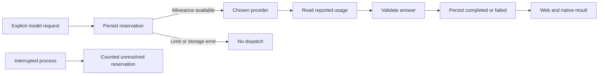

# Model usage and request limits

The web and native iOS Coach now include **Model usage**: the current UTC month, requests used/remaining, outcomes, reported token totals, configured model names and average response time per provider. The allowance is shared across both bed sides, every connected client and all four model adapters, including Ollama. Local calculations do not consume it and remain available when it is exhausted.

New ledgers start at **100 model attempts per UTC calendar month**. Set a whole-number limit from 0 to 1000; zero pauses new model requests. A lower limit does not erase earlier attempts. The limit persists across restarts and month changes. Changing it affects future requests; an already dispatched request can still finish. Per-request sharing permission and the existing thirty-second model cooldown still apply.

This is a request allowance, **not a dollar spending cap**. The same number of requests can have different costs across models and prompt sizes. Token totals are incomplete whenever a provider does not return usable usage, and this feature does not reconcile invoices, enforce an account-wide provider budget or measure coaching quality. It only counts calls made through this server's Coach endpoint after installing this version. Previous calls and other applications' usage are not imported.

## Request lifecycle

1. Validate the request, sharing choice and provider configuration, then load the selected analytics and journal patterns.
2. Atomically reserve one attempt on disk before invoking the adapter. If storage is unavailable or the monthly allowance is exhausted, no model request is dispatched.
3. Capture token usage when the adapter receives a parseable response. This occurs before validating the model's answer, so a refused, truncated or invalid result can still have recorded usage.
4. Persist the completion or failure before responding to the client. A storage failure does not retry the provider. The original reservation remains counted.

**Completed** means the server produced a valid coaching response, not proof that a client received or read it. **Failed** includes rejected answers and transport failures. **In progress** is an unfinished reservation; after two minutes it is labelled **unresolved**. That label covers crashes, interrupted work and a completion that could not be saved. Neither failed nor unresolved attempts are refunded, because a provider may have accepted work. Client cancellation is not a billing cancellation guarantee. Every user retry creates a new attempt and still requires sharing permission.

The month is assigned when the attempt is reserved, using the server clock in UTC. A response finishing after midnight settles the original month's attempt. The next reservation in a new month uses a fresh allowance. Moving the clock back to an earlier recorded month rejects new model requests until it is corrected. Keeping accurate server time remains necessary; the ledger cannot infer true time from a clock that jumps forward.

## Storage and privacy

`<DATA_FOLDER>/analytics/model-usage.json` is separate from the scheduling databases. It stores a schema version, limit/revision and request metadata: a local random ID, configured provider/model, start time, outcome, elapsed time and optional token counts. It stores no question, generated answer, sleep measurement, journal note, side or credential. The UI exposes aggregate counts, not the individual reservation IDs.

Writes are serialized within the single Pod server process, use a private temporary file, sync its contents, atomically rename it and sync the containing directory. Files are mode `0600`; new directories are `0700`. Malformed existing data is preserved and blocks model calls instead of being silently reset. New reservations prune entries before the current month and preceding eleven months. The ledger is bounded to 12,000 attempts. Run one server process per data folder; the writer is not a multi-process or distributed database. Embedded storage behavior still needs Pod qualification.

Saving a limit compares its original revision with the current revision. A change from another client returns 409. **Refresh usage**, then **Reset draft**, loads the latest limit before editing again; refreshing alone preserves an unsaved draft and its original revision. No usage-clear endpoint is exposed that could reset an active allowance.

## Token interpretation

Checked against primary provider documentation on 14 October 2026:

- **OpenAI:** `input_tokens`, `output_tokens` and `total_tokens`. Output usage already includes non-visible generation; reasoning and cache detail fields are not added again. [Token counting](https://developers.openai.com/api/docs/guides/token-counting).
- **Anthropic:** input tokens combine uncached input, cache creation and cache reads. Output tokens are added once. [Prompt caching usage fields](https://platform.claude.com/docs/en/build-with-claude/prompt-caching#tracking-cache-performance).
- **Gemini:** input combines prompt and any tool-use prompt tokens; output is the reported total minus that input, including thinking. Cached content is already part of the prompt count. [Generate Content usage metadata](https://ai.google.dev/api/generate-content?hl=en#UsageMetadata).
- **Ollama:** prompt evaluation and generated-token counts are combined once. Cached-prompt detail is not added again. [Chat response fields](https://docs.ollama.com/api/chat).

Missing, negative, fractional, excessive or inconsistent counts remain unknown. Reported totals and their coverage appear together, such as “3,950 reported tokens · usage available for 3 of 4 requests.” Provider tokenizers differ, so token counts alone are not a fair model-quality comparison. Response times are measured by the server around the adapter, including failed responses with a settled duration; they exclude the reservation and settlement writes. Displayed times round to tenths of a second consistently on both clients.

## API and installation

- `GET /api/ai/usage`: current-month aggregate response, schema version 1, limit/revision, reset instant and provider breakdown.
- `POST /api/ai/usage/limit`: `{ "monthlyLimit": 25, "originalRevision": 0 }`; returns the updated aggregate. Invalid input returns 400 and conflicting edits return 409.
- `POST /api/ai/coach`: existing response shape; new model requests are subject to the server allowance. Exhaustion returns 429 and unavailable usage storage returns 503. Local calculations bypass the usage store.

Install the updated server, gateway and clients together. The gateway allows only the exact new read and limit-save routes/methods. They use the same configured connection authentication as the other app endpoints. Older clients receive an explanatory error when the server blocks a model request. New clients with older servers show that usage could not be loaded and suggest updating. The existing coaching response remains compatible.

The shared `usage-demo.json` fixture contains synthetic attempts only. Generate or check it with `node --import tsx scripts/generateUsageDemo.ts [--check]` from `server/`. Web and iPhone demos keep edits in memory, simulate allowance exhaustion and never contact a model or saved Pod address.

## Evidence and remaining work

Server tests cover concurrent admission, restart persistence, failed/unknown usage, malformed storage, UTC rollover, clock rollback, retention, stale edits and actual HTTP request handling with mocked providers. Storage failures before and after generation prove that no retry occurs. Native tests cover the shared fixture, exhaustion, stale drafts, late loads, duplicate saves and exact HTTP payloads. Gateway tests check the new allowlist and forwarding. See [validation evidence](VALIDATION.md) for executed builds and UI checks.

No provider credentials, owner health records or actual model calls were used. A measured cross-provider quality evaluation, exact billing reconciliation and a conservative monetary budget remain separate work; this does not complete the roadmap's full AI quality/cost center.
