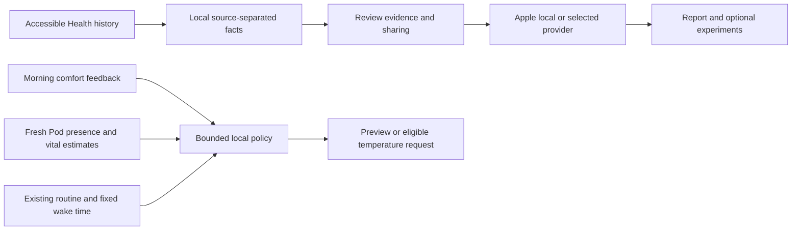

# Personal intelligence and sensor-aware Autopilot

Research and implementation: 14 October 2026. This is a working software implementation with automated and simulator checks, not a clinically validated sleep system or an overnight hardware qualification.

## Use your own models

On iPhone, open **Coach → Open personal intelligence**, or the Personal intelligence link in Settings. Choose a provider, paste its API key, select a model, and run **Test model connection**. The test sends a synthetic prompt without Health or Pod information. A saved key or a model appearing in the catalog does not prove your account can generate with it.

| Provider | Integration | Initial choices |
| --- | --- | --- |
| Apple | Native Foundation Models, on the device | System model; requires eligible hardware, iOS 26+, enabled Apple Intelligence and downloaded model |
| OpenAI | Native Swift SDK, direct Responses API | `gpt-6-astra`, `gpt-6.1-sol`, `gpt-6-luna` |
| Gemini | Native Swift SDK, direct generateContent API | `gemini-4-argon`, `gemini-3.8-flash`, `gemini-3.5-flash-lite` |
| Anthropic | Native Swift SDK, direct Messages API | `claude-fable-5-1`, `claude-opus-5-5`, `claude-sonnet-5-5` |
| Ollama | Direct local-server API | Installed model tag, for example `gemma3:4b` |

These catalog choices were checked against the providers' model documentation on the research date. Refresh available models to query your account; the model ID is also editable. Catalog presence does not establish compatibility with every endpoint. There is no automatic provider fallback. Ollama runs on your computer/server, not inside the iPhone; use a reachable LAN address or authenticated private network. Do not expose an unauthenticated Ollama port publicly.

Apple is the default because compact evidence summaries can stay on-device. For more demanding interpretation, start with OpenAI's flagship, Gemini's flagship, or Claude's strongest reasoning option and compare their reports against the same facts. We have not performed a sleep-specific model benchmark, so this is a capability-based choice, not a claim that one model improves sleep more than another. A large language model is not the right component for real-time sensor classification or motor safety.

## SDK provenance and keys

OpenAI does not publish an official Swift SDK in its supported language list. Google's old `generative-ai-swift` library is deprecated; Firebase AI Logic entails a different Firebase-mediated setup. Free Sleep uses the maintained **AIProxy Swift community SDK**, pinned to `b9375912d21ad2e5a50d4ea47607af0c3af140a1`, for direct OpenAI, Gemini and Anthropic requests. It does not use AIProxy's hosted proxy, accounts, DeviceCheck or stable identifier. The MIT license ships in the app. Source request bodies are compiled and tested against the pinned package.

- Keys are saved separately per provider in Keychain, `WhenUnlockedThisDeviceOnly`, with iCloud synchronization disabled. They are never copied to UserDefaults, the Pod, Replit, reports or Git.
- SDK body logging and stable identifiers are disabled. Errors are sanitized; no automatic retries occur. OpenAI Responses requests set `store: false`; provider policies still govern data processing and any abuse-monitoring retention.
- Each cloud report requires explicit sharing of the displayed calculated evidence and question. Changing provider, model, host, question or evidence clears consent. Raw Health samples are not sent.
- The monthly limit counts cloud generation attempts on this device, including tests and failures. It is separate from the Pod coach's limit and is not a dollar budget. Token counts are shown when supplied by the provider.
- Reports have no actuator tools. They suggest optional experiments; they cannot move the base or change temperatures.

The pinned SDK's resource privacy manifest includes custom data/purpose strings for its unused proxy service. A documented Xcode build step replaces that resource manifest before signing with Free Sleep's direct-use declarations: optional Health and user-content processing, app functionality, no tracking, and app-owned UserDefaults access. Both bundled manifests are inspected in the exported release. This does not substitute for App Store privacy disclosure when submitting a public release.

## Historical Apple Health analysis

Select **Connect & read Health history** to request sleep, resting heart rate, HRV and respiratory-rate read access. The first anchored query reads all accessible sleep records in batches, not an arbitrary 30- or 90-day cutoff. Each refresh reconstructs the import and reconciles deletions. Apple does not reveal whether an empty result means denial or no data.

Sleep sources remain separate, and you choose the source. Overlapping asleep intervals are unioned within that source, split at local noon using calendar/DST rules, and invalid, future or extremely long samples are rejected. Free Sleep's own occupancy exports are excluded. Deep/REM durations only come from explicit Health categories. Missing values are unknown, never zero. Naps can affect the noon-to-noon aggregation and bedtime estimates.

The app stores all imported nightly aggregates locally. Report evidence includes all-time coverage, recent 28-day medians, sufficiently sampled week-versus-prior comparisons, and optional daily resting HR/HRV/respiration summaries. Daily vital averages are not claimed to be overnight measurements or measurements from the selected sleep source. Optional Pod evidence is explicitly tied to the side you personally use and distinguishes occupancy from sleep.

Derived history and the latest 30 reports use complete file protection and are excluded from device backup. Raw Health samples are not persisted. With refresh enabled, reopening the app can refresh at most every six hours; this is not a promise of continuous background execution. Forget removes this local history/report archive without deleting original Health records or API keys.

Reports cite fact IDs, state uncertainty and offer at most three small experiments. Re-importing history lets later reports reflect new sleep patterns; this is evidence-based refresh, not fine-tuning a personal foundation model. Suggestions do not automatically rewrite routines. The existing morning comfort journal separately learns bounded per-side thermal preferences.

## What runs overnight

See [adaptive comfort](ADAPTIVE_COMFORT.md) for the complete command policy. The always-on Pod server checks every 30 seconds. The new opt-in sensor-aware mode waits for a seven-day personal vital baseline and two fresh complete five-minute windows. Unusual estimates or missing/stale data withhold extra adjustments. Eligible changes are at most 1°F at a time, at least 30 minutes apart and within both user limits and ±3°F of the original routine. Stable early/late bed entry can shift intermediate temperature phases by up to 30 minutes while power boundaries and alarms stay fixed.

Eight Sleep describes Autopilot as adapting temperature/elevation using proprietary measurements and learned patterns. Its snoring system uses cover vibrations and a separately trained classifier. This repository has neither that classifier nor a validated snoring event feed. **Automatic snoring elevation is not enabled.** Manual calibrated base controls remain separate. The existing biometric processor filters/clamps estimated heart rate to 30–90 bpm; this cannot support claims of abnormal high-heart-rate detection, medical alerts or treatment. Temperature is not inferred from heart rate.

The owner's last confirmed setup is stock Eight Sleep. Live operation requires a qualified Free Sleep controller on the Pod, its reachable API and verified sensor/control behavior. Installing this iOS build does not unlock stock vendor firmware. For the current Replit gateway use one Reserved VM, not AutoScale: the gateway holds one in-memory connection to the local Pod agent. The iPhone, cloud LLM and Replit are not required for the local overnight policy once configured.

## Primary research

- [Eight Sleep Autopilot](https://www.eightsleep.com/autopilot/) and [snoring detection and mitigation](https://www.eightsleep.com/blog/snoring-detection-mitigation/): vendor capability descriptions, not independent validation of Free Sleep.
- [OpenAI SDKs](https://developers.openai.com/api/docs/libraries), [models](https://developers.openai.com/api/docs/models).
- [Gemini libraries](https://ai.google.dev/gemini-api/docs/libraries), [models](https://ai.google.dev/gemini-api/docs/models).
- [Anthropic model overview](https://platform.claude.com/docs/en/models/overview).
- [AIProxy Swift source and direct-service usage](https://github.com/AIProxyTeam/AIProxySwift).
- [Apple Foundation Models](https://developer.apple.com/documentation/foundationmodels/generating-content-and-performing-tasks-with-foundation-models), [context management](https://developer.apple.com/documentation/foundationmodels/managing-the-context-window).
- [Gemma mobile integration](https://ai.google.dev/gemma/docs/integrations/mobile): an embedded Gemma runtime/download is not part of this build.
- [Reading HealthKit data](https://developer.apple.com/documentation/healthkit/reading-data-from-healthkit), [privacy manifests](https://developer.apple.com/documentation/bundleresources/describing-data-use-in-privacy-manifests).
- [Replit deployment types](https://docs.replit.com/features/publishing/deployment-types).

See [validation](VALIDATION.md) and [TestFlight release](TESTFLIGHT_RELEASE.md) for evidence and distribution status. Personal provider credentials, real Health history and overnight Pod hardware still need user-device verification.
