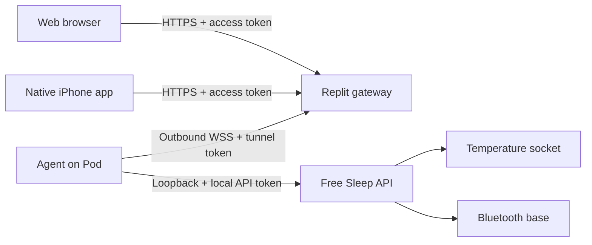

# Free Sleep web, iPhone and Pod setup

Free Sleep was installed on the owner's Pod 4 on 2026-10-25. The live web/API, authentication, database and Franken hardware connection were checked with the mattress cover disconnected. Physical temperature control, live biometric accuracy, adjustable-base motion and unattended adaptive comfort still require qualification. Subscription expiry alone does not install Free Sleep or establish access to its hardware.

Adaptive comfort is off by default. Its [configuration and qualification guide](ADAPTIVE_COMFORT.md) describes preview mode, feedback learning, temperature limits, manual pauses and the required presence heartbeat. Update the Python biometrics service alongside the server before evaluating this feature.

## Before migrating the stock Pod

1. Preserve the current working setup while recording firmware versions, bed model, existing schedules, temperature preferences, and base presets. Request/export any existing sleep history through Eight Sleep's supported account process while access remains. This implementation has no Eight Sleep account importer and does not promise access to subscription history after cancellation.
2. Read this repository's Pod 4 installation and recovery instructions, including its hardware/SSH access requirements. Establish a restorable stock backup before changing services or firmware. In particular preserve `/persistent/AdjustableBaseConfiguration.json`, BlueZ pairing state (normally `/var/lib/bluetooth`), and other persistent configuration. Keep these backups private. Do not run an installer intended for a different firmware generation.
3. Check that a usable BlueZ daemon and system D-Bus exist and that the Free Sleep service user can access the configured base. The new adapter does not create Bluetooth pairings, scan arbitrary devices, or replace the stock base configuration.
4. Qualify temperature and presence collection locally first. Then connect the base read-only and compare reported positions with the physical bed. Follow the small-movement/Stop checklist in [base research](research/base-control.md). Keep the stock controller available during attended tests.
5. Enable remote access and Apple Home only after those local checks. Cloud connectivity and an iOS build cannot validate motor calibration or a physical stop.

The documented installation used temporary U-Boot arguments, preserved stock configuration and disabled the stock controller/updater services before takeover. It did not save U-Boot environment changes, flash firmware or alter partitions. Configuration backups are not full flash images, and a successful installation does not establish readiness for unattended operation.

## Installing this fork

The installer, updater and client update check use `lucaandrea/free-sleep`. The original upstream installer installs a different application and does not include this fork's native integrations and platform features.

For an audited offline deployment, the installer accepts `FREE_SLEEP_ARCHIVE_URL=file:///absolute/path/free-sleep.zip`. The ZIP must contain the repository under `free-sleep-main/`, including the built server and web assets. Create that bundle from a reviewed commit with `git archive --format=zip --prefix=free-sleep-main/ COMMIT`. Run the installer from a dedicated empty directory on the Pod; do not run it on your Mac. A failed download or missing compiled server stops before replacing an existing checkout.

Before takeover, confirm the socket in `systemctl show frank.service --property=Environment --value`. Some firmware has no `/opt/eight/bin/frank.sh`; record the verified absolute `DAC_SOCKET` path in `/persistent/free-sleep-data/dac_sock_path.txt` before starting Free Sleep. Keep the `frank` and `capybara` hardware services running. Stop the stock `dac` service when handing the socket to Free Sleep.

The biometrics service launches from the `biometrics` directory using `python -m stream.stream`. Package-qualified imports also preserve the older direct-script launch; `stream.py` must not shadow the `stream` package. Verify the complete processing import graph and the running service, not only that its dependencies import. With the cover disconnected, dependency installation and a live NATS subscription do not establish receipt of usable sensor data. Defer calibration and thermal tests until reassembly and reconnection.

## Build and local development

Use Node 24.11 or newer. From the repository root:

```sh
npm --prefix server ci
cd server
npx prisma generate
npx tsc
npm run sentry:inject
npm test
npm run lint
cd ../app
npm ci
npx tsc -b
npm run lint
npm run build:hosted
```

`build:hosted` creates the web bundle in `server/public` without uploading source maps. The repo tracks compiled server and web output; regenerate both with source changes. Server start still needs its existing `DATA_FOLDER` (with trailing slash), `ENV`, and database configuration. Use `npm run dev:local` for the existing local development setup; it cannot control a real Pod without its socket.

For a clearly labelled browser demo: `cd app && npm run demo` (see `package.json` if using the Vite CLI directly). Demo handlers simulate controls and records; they do not reach hardware. To develop against a locally reachable, configured Pod: `VITE_POD_IP=<address> npm run dev`.

## Pod feature configuration

Use `server/.env.features.example` as a template for **additional environment variables**. The template is not loaded automatically. Preserve the existing `.env.pod` settings. On a qualified installation, supply the new values through the service environment or an additional private `EnvironmentFile`; keep secrets out of Git. Rebuild/restart the Free Sleep service after configuration changes.

- `FREE_SLEEP_API_TOKEN`: a random secret required by web/iOS requests. Legacy LAN installs without this variable retain their existing API behavior; never expose that API directly to the Internet. Narrow loopback endpoints remain available to existing biometric/root helpers.
- `BASE_CONFIG_PATH`: defaults to `/persistent/AdjustableBaseConfiguration.json`. The file must contain the stock `Address` and `SplitBase` fields. Click **Connect base** after starting the server. Movement requires recent real telemetry; previews do not move the bed. Both sides move together.
- `HOMEKIT_ENABLED=true`: opt in to the local bridge. TCP port defaults to `51826`; mDNS must work on the home network. The bridge identity and pairing survive in `DATA_FOLDER/homekit`. Back up that directory and never reset it as part of an upgrade. A corrupt identity produces an error rather than silently forcing re-pairing.
- `HOMEKIT_PORT`: optional dedicated TCP port, an integer from 1 to 65535. The pairing code is shown only after publication and mDNS advertisement complete. The publisher runs in a separate process; a fatal socket error is shown in Settings while the main server keeps running. Correct the configuration and restart the server to retry. See [bridge reliability](HOMEKIT_BRIDGE.md) for lifecycle status, process containment and cancellation.
- `HOMEKIT_BIND`: optional IP address for HAP advertisement selection. This does **not** restrict the TCP listener to that address: installed HAP uses a wildcard IPv4/IPv6 listener. Leave it unset for normal discovery; use network/firewall configuration for TCP isolation.
- Provider keys and model IDs: configure only the providers you want. OpenAI is the initial cloud recommendation; deterministic insights remain the default until you explicitly choose and authorize a model. Ollama belongs on a capable computer, not the embedded Pod. Set `OLLAMA_BASE_URL` to its reachable endpoint and install the selected model separately.

The coach sends numerical analytics, numerical journal patterns, and the question you type only after consent for that request. Journal notes and HealthKit samples are excluded. Models have no hardware tools. Cloud providers have not been called with the owner's credentials during this implementation.

Configured models must support their provider's structured-output schema. The server now resolves displayed observations from calculated facts and keeps generated suggestions separate. Unsupported, truncated or invalid model responses fail without switching providers or retrying automatically. See [Coach evidence](COACH_EVIDENCE.md) for current API formats and qualification limits.

Model usage starts with a persistent allowance of 100 attempts per UTC month, shared across both sides and all model adapters. Change it in Coach → Model usage; zero pauses model requests. Local calculations remain available. Install the new server/gateway routes with the clients. Reported tokens and request counts do not establish an exact dollar spending cap. See [model usage](MODEL_USAGE.md) for storage, failure accounting and reset behavior.

## Replit hosting

Use a **Reserved VM**, one instance, for the persistent Pod WebSocket. `.replit` builds the web UI and starts `gateway/server.mjs`; do not run the embedded Pod server in Replit. This follows [Replit's deployment types](https://docs.replit.com/features/publishing/deployment-types).

Autoscale is suitable for a separately published demo, but the current live gateway is not an Autoscale architecture: its Pod connection and pending requests live in one process. A second instance cannot use the first instance's connection, and scale-to-zero interrupts the persistent service. Keep one Reserved VM for remote control. A native iPhone can instead connect directly on the home network; it still requires the Free Sleep API on the Pod. Neither client controls stock Eight Sleep simply by signing in to an Eight Sleep account.

Reproduce the deployment build from a clean checkout with `node scripts/build-hosted.mjs`. Replit and the hosted CI job use this same command. It installs locked web and shared server-schema dependencies, builds `server/public`, then installs and tests the gateway. Server dependencies are needed only because the browser imports those TypeScript contracts; their install hooks are skipped, and no Pod service or database is started. No environment file, provider key or deployment token is needed for this build, and it does not upload source maps. Build tools are installed explicitly even when the hosting environment sets `NODE_ENV=production`.



1. Import this branch into the intended Replit project. Set two distinct secrets, each at least 32 random characters: `GATEWAY_ACCESS_TOKEN` and `POD_TUNNEL_TOKEN`. Generate each separately with `openssl rand -hex 32` and store them privately.
2. Deploy using the checked-in Reserved VM configuration. The unauthenticated `/healthz` reports gateway health only; it does not imply a connected Pod.
3. On the already-qualified Pod, install `gateway` dependencies with `npm ci --omit=dev`. Create `/persistent/free-sleep-data/tunnel.env` privately, containing `GATEWAY_URL=wss://<published-host>/tunnel`, `POD_TUNNEL_TOKEN`, and the Pod's `FREE_SLEEP_API_TOKEN`. Its local API is fixed to loopback; no router port forwarding is required.
4. Review and install `gateway/free-sleep-tunnel.service` with paths/user adjusted to the actual installation. This is a supplied service definition, not a service installed by this work. Enable it only when the local Pod is ready.
5. In web Settings, leave the address empty for the current hosted origin and enter the **gateway access token**, which stays in that tab's session storage. In iOS Settings enter the HTTPS published origin and the same access token; iOS stores it in Keychain. Model keys and the tunnel secret never go in either client.
6. Verify an unauthenticated API request returns 401, an offline Pod returns 503, and a permitted read works through the agent. Then test an attended command, disconnect during a request, and reconnect. In-flight commands fail and are not replayed automatically. Always inspect the bed before retrying an uncertain command.

The gateway forwards app operations through a fixed allowlist and bounded requests. Raw command execution, root maintenance jobs and log streaming stay LAN-only. It holds no sleep database, but authorized API data transits Replit. The hosted UI cannot call a private HTTP Pod directly from HTTPS; use the gateway or the local app.

The owner selected [free-sleep (1)](https://replit.com/t/replit/repls/free-sleep-1). On 2026-10-14 its Replit preview was verified in Safari as **Demo · sample data and simulated controls**. No live Pod connection or published production endpoint was verified. GitHub `main` at `68a525a` includes the web/gateway implementation; Replit's demo setup has its own changes and must be configured for the live gateway before production control.

## Native iOS

`ios/FreeSleep.xcodeproj` is a native SwiftUI project, generated from `ios/project.yml` using XcodeGen. Minimum iOS is 18; validation used the available iOS 27 simulator. No web view is used. Main screens share the web design; native system pickers and Apple permission sheets retain their platform behavior.

```sh
cd ios
xcodegen generate
xcodebuild -project FreeSleep.xcodeproj -scheme FreeSleep \
  -destination 'platform=iOS Simulator,name=Free Sleep QA' CODE_SIGNING_ALLOWED=NO test
```

Release signing is configured for Luca Andrea Collins, team `9FNNQ6J269`, with bundle ID `com.lucaandrea.freesleep` and HealthKit/HomeKit capabilities. A signed archive and App Store package have been verified and uploaded through Xcode. See [TestFlight release](TESTFLIGHT_RELEASE.md) for the current processing/tester status and reproduction steps. Real-device permission and hardware checks remain separate. Use Safari when working in Apple's portals.

- **Health:** Choose your personal Health side independently of the browsing selector, choose permissions, and link it to the current Pod before syncing. Presence becomes `inBed`; optional range-filtered heart rate keeps its Pod provenance. Repeat exports use stable IDs and update versions; obsolete exports are removed only from this app's matching Pod/side/date window after replacements save. Unvalidated Pod HRV/breathing and fabricated sleep stages are never exported. Apple Health sleep, heart rate, SDNN HRV and respiration comparisons stay on the iPhone. Read denial is intentionally indistinguishable from empty data in HealthKit. Opt-in automatic sync runs on app activation and requests background time from iOS after a successful initial sync; execution timing is not guaranteed. Settings and Shortcuts can manually reconcile thirty days. See [Apple integrations](APPLE_INTEGRATIONS.md) for cancellation, identity checks and retry behavior.
- **Home:** Enable the local HAP bridge, connect the base in the app, and use the pairing code in Settings to add it to Apple Home. Thermostats expose both sides; named switches expose positions, Stop and priming. The bridge is not an Apple-certified accessory. Native Settings can also list and run the user's existing Home scenes after permission. Remote Apple Home automations require a supported home hub. Base actions need a connected, qualified base; the bridge does not silently reconnect and move after a restart.
- **Shortcuts/Siri:** Find sixteen Free Sleep actions for power, setting/reading temperature, preset, head/feet angles, Stop, comfort mode, Away mode, priming, alarm dismissal, next-alarm read/change/skip/restore, routine summary and Health sync. Health sync uses the linked personal side, and both personal-data actions require local device authentication. They use the same saved authenticated connection and return errors offline. Discovery metadata was generated by Xcode; actual Siri execution and locked-device behavior require a signed device check. Returned text acknowledges a command, not proof of physical motion. See [alarm behavior](ALARMS.md) for one-time editing rules.

## What this does and does not replace

Available: temperature control, per-side weekly routines and vibration alarms, manual head/feet previews and commands, base presets/Stop, local presence/vital trends and quality notes, calendar-week comparisons, morning journal and habit associations, private deterministic coaching, opt-in cloud/local LLM coaching, HealthKit export/comparison, Home bridge and App Intents.

Not established: Eight Sleep's proprietary sleep staging, calibrated readiness scores, apnea/snoring classification, automatic anti-snoring base movement, or a learned closed-loop thermal Autopilot. The app makes no medical-equivalence claim. Sensor qualification and a separate evaluated control policy are needed before adding those features. The coach never changes the bed autonomously.
