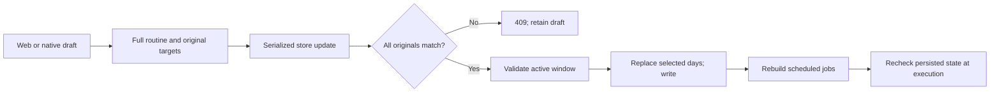

# Routine editing

The web app and native iPhone app use the same sequence: choose a side and day, preview the overnight temperature plan, edit power and adjustments, set the vibration alarm, then save or copy to other days. Demo mode uses `shared/fixtures/routines-demo.json` on both platforms. These are sample targets, not readings from a Pod.

## Times and temperature

- A day names the day the routine **starts**, in the Pod's timezone. For Monday 22:00–08:00, an adjustment at 02:00 belongs to Tuesday morning.
- The chart shows step changes in planned targets. Actual water temperature changes gradually. It includes the turn-off boundary and a dashed alarm marker when the alarm is inside the active window.
- Enabled routines require different start/end times. Adjustments and an enabled alarm must fall strictly inside that window. Clock values are `HH:mm`; target temperatures are 55–110°F, displayed in the chosen unit.
- Turning a routine off permits saving an old routine with an invalid time window so it can be paused. Structural field validation still applies. Cross-day overlapping windows are not currently detected.
- The adjustment editor supports Add, Edit, Remove and Cancel. Adding a time that already exists shows an error; it does not silently replace that adjustment. Removing every adjustment saves an empty map.
- The legacy `alarmTemperature` field is preserved for compatibility but is not a scheduled warming command. To warm before waking, add a temperature adjustment.

## Drafts, copies and conflicts

Drafts are kept in memory, scoped to the connection/Pod identity, side and day. Switching screens, sides or days retains them within the running app. Closing the app or reloading the browser loses them; the web app registers an unsaved-change warning while drafts exist. These drafts are not an offline persistence feature.

Weekdays means Monday–Friday; Weekends means Saturday–Sunday. The current day remains selected. Every day selects the full week; Clear removes additional destinations. The screen lists every day that will be replaced. Saving copies power, all temperature adjustments and all alarm settings. It preserves the opposite side and unselected days, including explicit disabled flags and deleted adjustments.

A destination with its own local draft must be saved or reset before another routine can be copied onto it. Each draft retains the original values from when editing began, even after a background refresh. The server compares the original values for **all** selected days before changing any of them. If another client edited a target, the entire save returns a conflict and the draft remains available.

Reload saved asks for confirmation, refetches the week, then clears only the currently selected draft, copy selections and adjustment-editor state. A failed reload preserves the draft. Clients reject an incomplete week and show a retry state.

## Vibration and execution

Alarm intensity accepts 1–100%; duration accepts 1–180 seconds. The hardware executor imposes a minimum of ten seconds. The selected side must be on when a scheduled alarm fires. Changing an alarm does not extend power-off; see [one-time alarm behavior](ALARMS.md).

Test vibration explicitly confirms a ten-second immediate test, including when the routine is off. It requires a local connection; the hosted gateway excludes the force/test route. In demo mode it remains simulated.

Disabled routines no longer create temperature jobs. Power, adjustment and recurring-alarm callbacks reread current persisted settings and schedules before issuing a command. A changed timezone, away mode or disabled routine suppresses an old callback while the filesystem watcher rebuilds jobs. Changed start times and removed/changed commands also suppress stale callbacks; recurring alarms use the current vibration profile. This does not undo a command already sent or establish physical-device reliability.

## Save API

Deploy the matching server, web/iOS clients and gateway together. Both clients save via `POST /api/schedules/routine`:

```typescript
{
  side: 'left' | 'right',
  days: ['monday', 'tuesday'],
  schedule: DailySchedule,
  expected: {
    monday: originalMonday,
    tuesday: originalTuesday
  }
}
```

`days` contains one to seven unique days. `expected` must contain exactly those days, each with its full original routine. A successful response is the complete schedule book. Invalid input or timing returns 400; a changed target returns 409; a storage failure returns 500. All checks happen before a copy is committed through the serialized JSON-store updater.



The legacy `POST /api/schedules` remains available for older clients. Its partial power/alarm writes preserve omitted fields; an explicitly supplied temperature map replaces the map, including `{}`. It does not provide the new expected-value conflict contract.

## Evidence

Server route tests use temporary stores and fake command senders; native tests use the shared fixture. Browser and simulator checks cover simulated editing and copying. See [validation](VALIDATION.md) for counts and captures. No owner Pod, vibration or real sleep data was used to validate this milestone.
