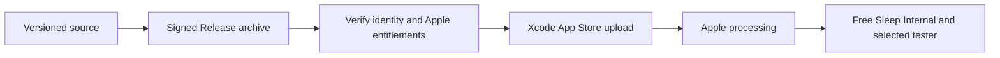

# Free Sleep TestFlight release

Release preparation: 14 October 2026, America/Los_Angeles.

- App: Free Sleep, `com.lucaandrea.freesleep`.
- Apple team: Luca Andrea Collins, `9FNNQ6J269`.
- App Store Connect app: [6822950204](https://appstoreconnect.apple.com/apps/6822950204).
- Candidate: version `0.1.0`, build `3`, iPhone and iPad, iOS 18 or newer.
- Internal group: Free Sleep Internal, with the requested owner account added. Builds are assigned explicitly; automatic distribution is off.
- Build 3 identifier: `38e827ef-ca41-41c0-a700-84361926be23`.
- The separate external Individual Testers flow remains pending the owner’s beta-review contact phone number and Apple beta review. This does not prevent the existing internal-group assignment.
- Status: build 3 signed archive and exported IPA verified. Xcode reported upload success at 17:54 PDT on 14 October 2026. Apple completed processing, and Safari confirmed build 3 assigned to Free Sleep Internal with one tester. Build 2 has not yet been expired: the Mac locked before that Safari action could be completed.

## Signing and packaging

The existing development certificates had no private key on this Mac. A new Apple Distribution certificate was created through Xcode without revoking any existing certificate. Safari was used to register the bundle ID with HealthKit and HomeKit and create the dedicated `Free Sleep App Store 2026` distribution profile.

Release uses manual distribution signing so Product → Archive does not depend on the unavailable development key. Debug retains automatic signing. Private keys and provisioning files remain outside Git. The profile expires 14 October 2027 and must be renewed before subsequent releases after expiry.

The generated Info.plist now uses the project version/build settings, declares supported iPhone/iPad orientations, and records exempt encryption. The app links Apple's native frameworks and the pinned AIProxy Swift SDK for direct provider requests, using system URLSession/Keychain encryption. Both bundled privacy manifests declare optional Health/user-content processing, app functionality, app-owned UserDefaults access (`CA92.1`) and no tracking. The SDK's proxy-specific manifest is replaced before signing as documented in [native intelligence](NATIVE_INTELLIGENCE.md). These declarations do not replace the separate App Store privacy questionnaire for a future public release.

Build 3 uses a signed archive. Both the archive and exported IPA passed strict signature verification, the expected team/bundle identity, `get-task-allow=false`, **both** HealthKit and HomeKit entitlements, version/build values, bundled privacy manifests and the SDK license.

IPA SHA-256: `924ce19ac5b4e2d42d9eb2e6cca9e63d345d96707caa1033a44ac244d61d4896`. The verified archive is saved in Xcode Organizer under 14 October 2026; the IPA and UI evidence are kept in the owner’s local Free Sleep Releases folder, outside Git.

## Reproduce with Xcode

Install the matching distribution certificate/private key and provisioning profile first. From the repository root:

```sh
xcodebuild -project ios/FreeSleep.xcodeproj -scheme FreeSleep \
  -configuration Release -destination 'generic/platform=iOS' \
  -archivePath /tmp/FreeSleep.xcarchive archive

xcodebuild -exportArchive -archivePath /tmp/FreeSleep.xcarchive \
  -exportPath /tmp/FreeSleep-export -exportOptionsPlist ios/ExportOptions.plist

codesign --verify --deep --strict /tmp/FreeSleep.xcarchive/Products/Applications/FreeSleep.app
codesign -d --entitlements - /tmp/FreeSleep.xcarchive/Products/Applications/FreeSleep.app
```

Inspect the exported IPA as well as the archive before uploading. Use Xcode Organizer → Distribute App → App Store Connect, or a private copy of ExportOptions.plist with `destination=upload` for `xcodebuild -exportArchive`. Increment `CURRENT_PROJECT_VERSION` for each new upload and regenerate the project after changing `ios/project.yml`.



## Included in build 3

Personal intelligence adds Keychain-backed OpenAI/Gemini/Anthropic keys, live model catalogs and editable IDs, a synthetic model test, Apple Foundation Models and an Ollama option, all-accessible-history Health import, protected reports and explicit evidence sharing. Sensor-aware Autopilot adds fresh-vital/baseline guards and optional bounded early/late bed-entry phase alignment. Automatic snoring elevation is unavailable; no validated snoring signal exists in this repository. See [implementation and research](NATIVE_INTELLIGENCE.md).

## What this release proves

Archive/export signing establishes distribution identity and bundled capabilities. It does not establish Health/Home permission on a real iPhone, live Siri execution, Pod reachability, calibration, physical motion or overnight reliability. Release builds require a configured Free Sleep API and ignore the Debug demo argument. The owner's stock Eight Sleep installation still needs a separately qualified local installation before either client can control it.
