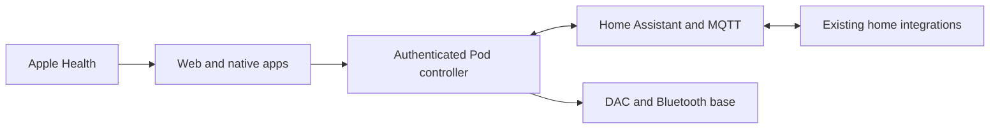

# Unified Sleep implementation

Approved 25 October 2026. This file tracks implementation evidence; it is not a hardware acceptance certificate.

## Architecture

- Core fork: https://github.com/lucaandrea/sleepypod-core, branch `lucas-assistant/unified-sleep`.
- Upstream baseline: v3.4.0, `f8948b04586542fab1817aadc72b65a9c2988f8c`.
- The legacy native implementation remains in this repository. The current product client is maintained separately in `../sleepypod-ios`; the owner subsequently requested SleepyPod's original presentation with Free Sleep features added in that style. That client task records separate distribution permission and its release evidence in `Integration/VALIDATION.md`. No upstream native source is imported by this backend branch.
- Pod owns hardware, scheduled temperature, wake alarms and bounded comfort policies.
- Lenovo hosts Home Assistant OS, Mosquitto and private Tailscale access. Existing Homebridge/Apple Home pairings stay in place.

## Gates

| Gate | Evidence required | State |
| --- | --- | --- |
| Recoverable migration | SQLite online backup, separate private configuration, restore rehearsal | Data candidate and installation/Bluetooth file restoration verified; live operational rollback and native/editor qualification still pending |
| Core integration | Pod 4 occupancy, authentication, comfort arbitration, native compatibility | In progress |
| Apps | Matching presentation and 3D controls; accessibility; real unavailable states | Earlier five-destination experiment superseded by owner direction in the client chat: original SleepyPod presentation. Separate native build 7 is recorded; corresponding web alignment and controller acceptance remain pending |
| Home host | Windows/hypervisor/storage preflight, VM startup, broker and private access | VM running; owner onboarding complete; MQTT and private HTTPS verified; daily backups and an off-host archive verified; graceful VM stop/start recovered HTTPS/MQTT; Pod MQTT credentials, restore rehearsal and Windows reboot tests pending |
| Physical controls | Attended base/Stop, vibration/cancel, presence and temperature checks | Pending |
| Preview | At least seven actual nights, Apple Watch comparison, proposal review | Not started |
| Active / TestFlight | All applicable gates; explicit evidence and release record | Separate native UI build 0.2.0 (7) is reported in internal TestFlight; unified Core activation and hardware acceptance remain pending |

Adaptive control, autonomous base movement and music remain disabled until their qualification gates pass. Simulated evidence cannot mark these gates complete. Keep the current Free Sleep installation and dedicated SSH service until the new controller has passed migration and recovery checks.

## Verified foundation work

- The working Pod services remained running during backup. No controller switch or hardware command was issued.
- Private backup: `~/Downloads/FreeSleep-Unified-Migration-2026-10-25/`. It is deliberately outside Git.
- The pinned Core fork now supports calibrated legacy capacitance, rejects incomplete and stale readings, and requires owner access across API and streaming routes. See its `docs/OWNER_ACCESS.md`.
- The owner's PowerShell screenshot identifies a Lenovo ThinkPad T450s (20BXCTO1WW), Windows 10 Home 10.0.19045, Intel i5-5300U, 12 GB RAM and 93 GB free on C:. This supersedes the initial 64 GB assumption. No hypervisor or VirtualBox/VMware installation was reported. The owner then enabled Intel Virtualization Technology in BIOS and reported the verification command returned True. The planned VM allocation remains 2 vCPUs, 4 GB RAM and a 64 GB dynamically allocated disk.
- RustDesk works for the owner, but desktop-control inspection times out on the Mac. A similar upstream report exists ([RustDesk discussion 16553](https://github.com/rustdesk/rustdesk/discussions/16553)); a shared cause has not been established. Microsoft Remote Desktop hosting and Hyper-V are not assumed available on Windows Home.
- The private Tailscale SSH setup service now runs and accepts the dedicated Mac key. Its first start failed because the generated host key retained Windows user ownership; Administrators ownership and SYSTEM/Administrators-only access fixed the service. The installer now applies that ACL. Homebridge stayed running, the host uses wired Ethernet, and firmware virtualization was independently verified over SSH.
- VirtualBox 7.2.22 and HAOS 18.3 were downloaded from their official sources and checked against published SHA-256 values; Oracle/Microsoft installer signatures also verified. The 2 CPU/4 GB RAM/64 GB dynamic-disk UEFI guest boots over bridged Ethernet. Home Assistant Supervisor reports Connected, Supported and Healthy. A SYSTEM startup task starts the isolated VM without requiring a Windows login. Full Windows restart recovery has not been tested.
- Home Assistant onboarding is complete. The official Mosquitto 7.1.2 app runs with start-on-boot/watchdog, and HA's MQTT integration uses generated internal credentials. Anonymous MQTT connections are rejected. No Pod client account or topic permissions have been configured yet.
- Private Home Assistant HTTPS now runs through Tailscale TLS-terminated TCP and a Windows loopback relay to `homeassistant.local`. Verified certificate validation, HTTP 401 without authentication, WebSocket `auth_required`, and no LAN reachability of the loopback relay. The owner enabled account HTTPS support; no Funnel, public forwarding or HA authentication bypass was enabled. This URL is not a deployed Core controller.
- Daily backups retain seven copies and include settings/history, all apps and the shared folder; two backups completed. App updates now back up first and retain one version. The owner saved the recovery key privately and downloaded the backup through Safari after the in-app download failed. The outer archive and all five nested compressed archives passed inspection. An owner-only copy and checksum record are outside Git on the FileVault-enabled Mac. The downloaded export is decrypted; restore rehearsal remains pending. See [home-host operations](../scripts/home/README.md).
- The Home Assistant VM passed graceful ACPI shutdown and restart through the SYSTEM startup task. Private HTTPS, authenticated API/WebSocket boundaries and MQTT recovered. Homebridge and Tailscale stayed running. This does not establish full Windows reboot recovery or operation after a DHCP lease change.
- Core authentication, live sensor parsing, occupancy, navigation, startup and migration checks: 521 tests passed in 19 files. Changed TypeScript files pass ESLint. Production build passes with isolated, pre-migrated SQLite databases; an initial build against brand-new files encountered parallel WAL initialization contention.
- The broader Core pre-push gate subsequently passed TypeScript, full ESLint, both Drizzle schema checks, and 3,507 related tests across 148 files. It exposed and resolved outdated authentication fixtures, a rolling-date fixture, and missing Python test dependencies (installed from the module's locked uv environment). Missing settings now also report Autopilot disabled across the API status/diagnostics surfaces.
- The pure personal comfort learner and isolated passive-policy arbitration are pushed to Core at `d5b160e`. Its 184 targeted tests and subsequent 2,718-test pre-push gate passed. This pure-policy milestone is superseded by the production Preview runtime described below; active lease application and vital/phase adapters remain pending. Client compatibility is planned under `/api/native/v1/`; see [client handoff](CLIENT_INTEGRATION_HANDOFF.md) for current routes and unavailable features.
- Core now implements authenticated `GET /api/v1/capabilities` at `9fe4c52`, with REST/tRPC/OpenAPI parity, passive runtime reads, explicit observation expiry and separate unverified physical status. Stop remains distinct from movement readiness. At that milestone, the legacy native adapter, production personal comfort and room context reported unavailable; the subsequent Preview capability is distinct from active comfort. Thirty-three focused tests, the broader 1,249-test gate and subsequent 435-test schema gate passed, along with TypeScript, ESLint and both Drizzle checks. The final production build passed; a loopback HTTP check verified missing/invalid key rejection, REST/tRPC/OpenAPI, private no-store headers, the build revision and honest unavailable hardware. The Pod has not been migrated.
- Core personal comfort Preview is implemented at `6b51f04`, with validation/loading-state follow-up `70e96a0`: SQLite state/check-ins/observations, live routine and sensor adapters, persisted six-hour manual pauses, an authenticated versioned API and a web Autopilot panel. The runtime has no actuator dependency. 564 focused tests and a 14-test UI/runtime follow-up passed, with TypeScript/full ESLint/both Drizzle checks. Production-build/loopback checks verified auth, Preview saves, activation rejection, feedback-date validation and OpenAPI; desktop/390px browser checks used isolated synthetic data. Active application, vital-window mapping, bedtime-phase adaptation and seven real Preview nights are still pending. Details and client schemas are in [the handoff](CLIENT_INTEGRATION_HANDOFF.md).
- The full Preview push gate passed 3,124 tests in 123 files. General automation signal validity at `5767b40` then added healthy DAC freshness, future/non-finite reading rejection, source-time checks for capacitance, current-source requirements for windows and policy withdrawal between trigger times. Its initial focused run passed 226 tests. The demo handler follow-up at `a016342` explicitly withholds comfort learning/writes; 90 focused demo/contract/runtime tests passed. The final production build and complete 2,745-test push gate passed with TypeScript, full ESLint and both Drizzle checks. This is software fault testing, not a physical outage test.
- Production-browser checks rejected an invalid synthetic connection key, accepted a valid local test key, and returned to the connection gate after signing out. No real Pod credential was used in these checks.
- Core now restores Autopilot's explicit saved opt-in before starting its timer, defaults new settings to disabled, and stays disabled if settings are absent or unreadable. The generated migration preserves existing device settings; migration tests verify this.
- Native Simulator build succeeds with five destinations and an independently drawn articulated bed. Tonight opens temperature and position controls explicitly. Native and web layouts are not yet identical, and the Home Assistant card reports its unconnected state.
- Backup utility: two tests passed, including an active WAL backup and local restore/hash verification. Private archives and credentials remain outside Git.
- The offline Core importer at `9ff9cd3` now verifies archive hashes/membership, stages generated SQLite schemas and retains original metrics/journal/history privately. It preserves overnight event weekdays through an explicit next-day power-off field; existing Core rows retain their calendar-day default. Personal comfort starts Off, learning cursors/manual pauses are preserved, and imported capacitance profiles remain pending until their different threshold semantics are qualified. Fourteen importer tests and 398 focused scheduler/API/Preview/schema tests passed; the final 3,832-test push gate (182 files), TypeScript, full ESLint, both Drizzle checks and isolated production build also passed. Foundation Core PR #1 was merged separately at `3c3dccd`; migration work is in follow-up PR #2. A real-backup rehearsal created 14 disabled power rows, 14 disabled alarms, six gestures and two default-Off comfort states; that snapshot had no biometric rows or check-ins. It changed no Pod services. The candidate and source archives remain outside Git. See [Core migration](https://github.com/lucaandrea/sleepypod-core/blob/9ff9cd3/docs/FREE_SLEEP_MIGRATION.md) for alarm warm-up, overnight editor, historical API and full-installation rollback gates.

## Installation recovery evidence

The reviewed live inventory captured 45,126 installation entries and 70 separate
Bluetooth-state entries. Both archives were downloaded and fully restored into
isolated private directories on the FileVault-enabled Mac. A fresh transactional
data backup also passed the offline Core importer, preserving its one enabled
power routine and zero enabled alarms, with comfort defaulting Off. The earlier
backup had all schedules disabled; these snapshots must not be conflated.
All 40 local script tests passed, including 12 new
recovery tests. The tool refuses existing destinations and archive traversal,
verifies contents and metadata, and deliberately has no live restore-to-`/` mode.

The aggregate private verification record confirms unchanged process IDs for
Free Sleep, its sensor service, SSH and Bluetooth, plus a 401 response to an
unauthenticated API request after capture. No controller or hardware state was
changed. This is file-restoration evidence, not a boot image or proof of runtime
rollback; original Linux permissions are recorded but not applied on the Mac.
The [recovery runbook](../scripts/migration/RECOVERY.md) records inventory scope,
artifact locations and the remaining attended rollback procedure.

## Current client direction and separately owned release

The owner's later instruction in **Add SleepyPod iOS and ESP32 apps** asks for
SleepyPod's original iOS presentation, with no Free Sleep UI and the added
features restyled to match. This supersedes the earlier five-destination visual
experiment for client alignment. The sibling `sleepypod-ios/Integration/VALIDATION.md`
records original Temp/Schedule/Sleep tabs, 270 unit and eight UI tests, signed
0.2.0 (7), and Safari verification of the internal group/individual tester.
The local upload log independently contains `Upload succeeded` and
`EXPORT SUCCEEDED` at 13:09 PDT. Apple portal assignments were verified by the
client task, not repeated by this backend task.

The owner also confirmed that the redesigned Waveshare display fits its circle
and touch works. That firmware remains owned by the client task and is visibly
unconfigured until compatible Core access is provisioned. Neither a UI release
nor this touch confirmation qualifies Pod movement, vibration, Apple permissions
or overnight adaptation. Keep the physical-control and Preview gates open.

## Still required before controller migration

1. Complete personal comfort vital-window/artifact and bedtime-phase adapters, then shared-authority application receipts and activation gates. The persisted Preview runtime and manual pause wiring are implemented.
2. Adopt the new versioned manual-control receipt endpoint in clients; add versioned measurements and the native app's compatibility endpoints. The receipt follow-up handles duplicate delivery, dispatch expiry and unknown outcomes, but is not deployed.
3. Complete cutover and attended operational rollback around the tested offline importer and installation file-recovery rehearsal. Qualify overnight editing, resolve changed alarm warm-up behavior and temporary overrides, and expose historical data without changing its metric definitions.
4. Add dedicated Pod MQTT credentials/ACLs, connect room context and notification delivery, and finish off-host restore and Windows recovery testing.
5. Qualify actual presence, base movement/Stop and vibration/cancel with the owner. No hardware qualification is implied by demo screenshots.
6. Record seven real Preview nights and review them before bounded activation and a new TestFlight release.

## Bedtime and control-receipt follow-ups

Merged Core bedtime PR #3 preserves whole overnight routines with revision conflicts,
atomic moves/replacements and the original parent/child enablement preferences.
Its production build, all six isolated browser checks, 16 importer tests and
4,432 related tests passed. The newer private recovery rehearsal verified all
14 complete routines, including one enabled power routine and no enabled alarms.

The subsequent `lucas-assistant/control-receipts` branch adds durable manual
control request IDs and deadlines at the DAC/Bluetooth write boundary. It removes
implicit write replay after socket failure, keeps acknowledgments separate from
physical evidence and reports interrupted/partial operations as unknown. Its
4,564-test push gate, production build and seven browser checks passed. See
[client handoff](CLIENT_INTEGRATION_HANDOFF.md#immediate-control-receipts-core-follow-up).
Neither follow-up has replaced the working Pod controller or started Preview nights.
