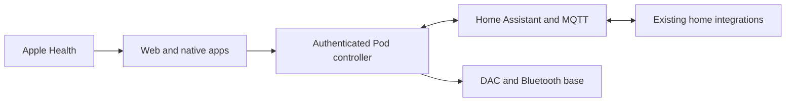

# Unified Sleep implementation

Approved 25 October 2026. This file tracks implementation evidence; it is not a hardware acceptance certificate.

## Architecture

- Core fork: https://github.com/lucaandrea/sleepypod-core, branch `lucas-assistant/unified-sleep`.
- Upstream baseline: v3.4.0, `f8948b04586542fab1817aadc72b65a9c2988f8c`.
- Independently implemented native app remains in this repository. No SleepyPod iOS source is imported.
- Pod owns hardware, scheduled temperature, wake alarms and bounded comfort policies.
- Lenovo hosts Home Assistant OS, Mosquitto and private Tailscale access. Existing Homebridge/Apple Home pairings stay in place.

## Gates

| Gate | Evidence required | State |
| --- | --- | --- |
| Recoverable migration | SQLite online backup, separate private configuration, restore rehearsal | Live data backed up; archives restored and hashes / SQLite integrity verified locally |
| Core integration | Pod 4 occupancy, authentication, comfort arbitration, native compatibility | In progress |
| Apps | Matching navigation and 3D controls; accessibility; real unavailable states | Five destinations and shared palette implemented; native 3D overview built and inspected in Simulator; full layout parity still pending |
| Home host | Windows/hypervisor/storage preflight, VM startup, broker and private access | VirtualBox 7.2.22 and HAOS 18.3 installed on the ThinkPad; 2 CPUs/4 GB/64 GB VM running, Supervisor healthy, owner onboarding reached; MQTT/private HTTPS/backups/reboot recovery still pending |
| Physical controls | Attended base/Stop, vibration/cancel, presence and temperature checks | Pending |
| Preview | At least seven actual nights, Apple Watch comparison, proposal review | Not started |
| Active / TestFlight | All applicable gates; explicit evidence and release record | Not released |

Adaptive control, autonomous base movement and music remain disabled until their qualification gates pass. Simulated evidence cannot mark these gates complete. Keep the current Free Sleep installation and dedicated SSH service until the new controller has passed migration and recovery checks.

## Verified foundation work

- The working Pod services remained running during backup. No controller switch or hardware command was issued.
- Private backup: `~/Downloads/FreeSleep-Unified-Migration-2026-10-25/`. It is deliberately outside Git.
- The pinned Core fork now supports calibrated legacy capacitance, rejects incomplete and stale readings, and requires owner access across API and streaming routes. See its `docs/OWNER_ACCESS.md`.
- The owner's PowerShell screenshot identifies a Lenovo ThinkPad T450s (20BXCTO1WW), Windows 10 Home 10.0.19045, Intel i5-5300U, 12 GB RAM and 93 GB free on C:. This supersedes the initial 64 GB assumption. No hypervisor or VirtualBox/VMware installation was reported. The owner then enabled Intel Virtualization Technology in BIOS and reported the verification command returned True. The planned VM allocation remains 2 vCPUs, 4 GB RAM and a 64 GB dynamically allocated disk.
- RustDesk works for the owner, but desktop-control inspection times out on the Mac. A similar upstream report exists ([RustDesk discussion 16553](https://github.com/rustdesk/rustdesk/discussions/16553)); a shared cause has not been established. Microsoft Remote Desktop hosting and Hyper-V are not assumed available on Windows Home.
- The private Tailscale SSH setup service now runs and accepts the dedicated Mac key. Its first start failed because the generated host key retained Windows user ownership; Administrators ownership and SYSTEM/Administrators-only access fixed the service. The installer now applies that ACL. Homebridge stayed running, the host uses wired Ethernet, and firmware virtualization was independently verified over SSH.
- VirtualBox 7.2.22 and HAOS 18.3 were downloaded from their official sources and checked against published SHA-256 values; Oracle/Microsoft installer signatures also verified. The 2 CPU/4 GB RAM/64 GB dynamic-disk UEFI guest boots over bridged Ethernet. Home Assistant Supervisor reports Connected, Supported and Healthy. A SYSTEM startup task starts the isolated VM without requiring a Windows login. Full Windows restart recovery has not been tested. Owner-account onboarding is the current handoff; MQTT, HTTPS and backup configuration remain pending.
- Core authentication, live sensor parsing, occupancy, navigation, startup and migration checks: 521 tests passed in 19 files. Changed TypeScript files pass ESLint. Production build passes with isolated, pre-migrated SQLite databases; an initial build against brand-new files encountered parallel WAL initialization contention.
- The broader Core pre-push gate subsequently passed TypeScript, full ESLint, both Drizzle schema checks, and 3,507 related tests across 148 files. It exposed and resolved outdated authentication fixtures, a rolling-date fixture, and missing Python test dependencies (installed from the module's locked uv environment). Missing settings now also report Autopilot disabled across the API status/diagnostics surfaces.
- The pure personal comfort learner and isolated passive-policy arbitration are pushed to Core at `d5b160e`. Its 184 targeted tests and subsequent 2,718-test pre-push gate passed. Production comfort persistence, sensor/schedule adapters and six-hour manual-pause wiring remain pending. Client compatibility is planned under `/api/native/v1/`; see [client handoff](CLIENT_INTEGRATION_HANDOFF.md) for current routes and unavailable features.
- Production-browser checks rejected an invalid synthetic connection key, accepted a valid local test key, and returned to the connection gate after signing out. No real Pod credential was used in these checks.
- Core now restores Autopilot's explicit saved opt-in before starting its timer, defaults new settings to disabled, and stays disabled if settings are absent or unreadable. The generated migration preserves existing device settings; migration tests verify this.
- Native Simulator build succeeds with five destinations and an independently drawn articulated bed. Tonight opens temperature and position controls explicitly. Native and web layouts are not yet identical, and the Home Assistant card reports its unconnected state.
- Backup utility: two tests passed, including an active WAL backup and local restore/hash verification. Private archives and credentials remain outside Git.

## Still required before controller migration

1. Port the personal comfort learner into Core's temperature authority, with persisted manual pauses and all input guards.
2. Add versioned measurements/control receipts and the native app's compatibility endpoints.
3. Build a reversible data importer, preserving routines, timezone, calibration, journal and learning cursors; test rollback against the preserved installation.
4. Finish Home Assistant/MQTT/private HTTPS on the verified Lenovo host, then connect room context and notification delivery.
5. Qualify actual presence, base movement/Stop and vibration/cancel with the owner. No hardware qualification is implied by demo screenshots.
6. Record seven real Preview nights and review them before bounded activation and a new TestFlight release.
