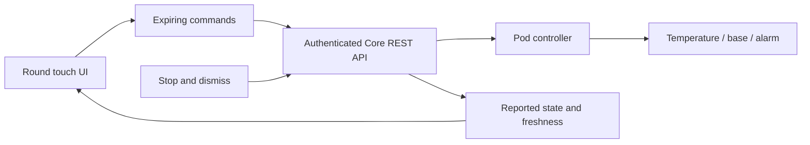

# Sleepypod bedside remote

A touch controller for **Waveshare ESP32-S3-Touch-AMOLED-1.75**, using its 466 × 466 round AMOLED and touch panel. Firmware 0.4.1 uses Sleepypod’s near-black palette, white capsule controls and a thicker temperature dial, adapted to the circular screen. It adds a rotatable 3D bed, articulated position preview and selectable sensor layers.

Version 0.4.1 adds two-stage USB setup and read-only connection diagnostics. **0.4.1 is flashed and the board has joined the owner's Wi-Fi with Preview off**, including after a restart. It is waiting for the compatible Core controller's LAN origin and owner key; real bed readings and controls are not connected yet. The previously accepted dial, mattress, color-coded sensors and round-screen navigation are retained. Evidence is in `docs/HARDWARE_CHECK.md`.

## Included controls

- Left/right temperature (55–110°F), measured temperature and power. More → Temperature display offers Degrees (°F/°C), Offset (whole °F from 80°F), and Eight Sleep (−10…+10; 0 = 82.5°F). Display mode, units and dial/mattress choice persist locally across restarts. Manual edits request a six-hour automation hold; More offers Resume automatic temperature.
- Switch between the thicker dial and rotatable mattress on Temperature. Each side changes from pale to saturated blue while cooling and pale to saturated red while heating, based on the reported gap to its target. Holding is neutral; off, stale or missing state is gray. Unapplied edits are labeled TARGET PREVIEW.
- Rotatable 3D bed, mattress/frame toggle and Sensor Layers with a bed preview and six colored value tiles. Tap All/None, Left, Right or an individual tile to choose visible measured regions. Sensor colors use a fixed 64.4–96.8°F scale, independent of target display mode. Ambient/MCU/humidity readings remain available. Missing or stale measurements stay gray.
- Whole-bed head (0–60°) and feet (0–45°) adjustments, Flat/Sleep/Relax/Read presets, speed selection, explicit Move, independent Stop, reconnect, and separately displayed reported position. Editing the preview does not move the bed.
- Per-side, per-weekday wake alarm time, enable/disable, intensity, duration, pattern, wake temperature and wake window. Dismiss and five-minute snooze. Alarm edits are saved on the Pod, so the remote can be off overnight.
- Wi-Fi reconnect, stale-data controls, expired-command rejection, no automatic mutation retries, and an independent Stop/dismiss worker. A successful HTTP reply is shown as accepted, never as proof of physical motion.
- Dim after 30 seconds; the first control interaction wakes the screen. Credentials are provisioned locally over USB, never embedded in the firmware image.

The remote targets the authenticated **SleepyPod Core fork** in the sibling `sleepypod-core` repository, documented in [the shared handoff](../../docs/CLIENT_INTEGRATION_HANDOFF.md). It does not directly speak the old Free Sleep REST shapes or the Franken socket. The physical Pod must be running the compatible Core controller before these controls work. This firmware does not migrate the Pod.

The controller must be reachable from the board's Wi-Fi LAN. The firmware has no Tailscale client, so a tailnet-only endpoint is insufficient. Home Assistant is a separate service and its address or access token must not be used as the Core connection.



## Build

Use ESP-IDF **5.5.5** and its ESP32-S3 toolchain. The project pins the official Waveshare BSP **3.0.1** and LVGL **9.4.0** in `main/idf_component.yml` and `dependencies.lock`. It configures 16 MB flash and octal PSRAM. Do not substitute a similarly named 1.8-inch or LCD board.

```sh
# From this directory, after installing ESP-IDF 5.5.5:
. "$IDF_PATH/export.sh"
idf.py set-target esp32s3
idf.py build
python3 tools/package.py
```

The package is written to `dist/free-sleep-waveshare-amoled.zip`, with separate images, flash offsets and SHA-256 checksums. Separate images preserve the NVS partition on a normal update; do not erase flash unless you intend to lose Wi-Fi and Pod configuration. The attached unit reports 32 MB physical flash; this image deliberately uses the first 16 MB, matching the vendor's published configuration. See `docs/HARDWARE_CHECK.md` for evidence and the restore procedure.

## Install and configure

Connect the board's USB port. If it does not enumerate, use the vendor's BOOT/RESET procedure. Verify the serial port belongs to this board before writing.

```sh
idf.py -p /dev/cu.usbmodemYOUR_BOARD flash
python3 -m venv .venv
. .venv/bin/activate
python3 -m pip install pyserial==3.5
python3 tools/provision.py /dev/cu.usbmodemYOUR_BOARD
```

To configure Wi-Fi before the Pod controller is ready, use `python3 tools/provision.py YOUR_PORT --wifi-only`. This preserves an existing controller connection; otherwise it exits sample Preview and shows Pod setup needed with unavailable readings and disabled bed commands. Run the normal setup command later to add the real origin/key. Wi-Fi alone does not establish bed control.

Read redacted connection/freshness flags with `python3 tools/provision.py YOUR_PORT --status`. This does not change configuration or issue hardware commands. It does not print credentials or measurements.

The normal provisioning tool prompts for SSID, password, controller origin and owner key. It does not write them to a file or print them. The key must be at least 32 characters. HTTPS validates certificates with ESP-IDF's CA bundle. Plain HTTP requires explicit opt-in and a private IPv4 or `.local` address; it exposes the bearer key to that local network. There is no public setup access point or default password. This development build stores configuration in NVS without flash encryption, so physical access to the board can expose it.

Use the controller origin only, such as `https://pod.example` or `http://192.168.1.10:3000`; do not include `/api`, credentials, query parameters or fragments. An existing configuration can be replaced by running the provisioning tool again over USB.

## Verification

```sh
cmake -S tests -B test-build
cmake --build test-build
ctest --test-dir test-build --output-on-failure
cmake -S tests/preview -B test-build/preview
cmake --build test-build/preview
python3 tools/verify_ui.py
```

The host test covers request limits, side isolation, absent measurements, powered neutral temperature, telemetry freshness, command expiry, base availability, alarm methods/fields and connection validation. The offscreen preview compiles the actual LVGL UI with synthetic state. The round-screen geometry and all 122 current route/state captures pass, including joining Wi-Fi, connected Wi-Fi without a Pod, missing/stale data and configured controller states. See [UI verification](docs/UI_VERIFICATION.md).

Before relying on it overnight, verify on the actual board: display/touch alignment, Wi-Fi loss and reconnect, TLS and owner-key rejection, each bed side's temperature, whole-bed movement and Stop, alarm timing in the Pod timezone, vibration and snooze, and restart persistence. The controller's alarm edit API lacks an atomic compare-and-swap contract; this client rereads before saving and rejects observed changes, but simultaneous edits can still race between that read and write. Multiple alarms on the same day currently expose the first alarm; use iOS for complex schedules.

## Sources

- [SleepyPod M5 rotary app](https://github.com/sleepypod/m5-rotary-dial), studied at `e93ab042e814493609e746dc726ccab3c20633e6`. Its input/navigation and API approach informed the design; no M5 hardware implementation was copied.
- [Waveshare board documentation](https://docs.waveshare.com/ESP32-S3-Touch-AMOLED-1.75).
- [Official BSP 3.0.1](https://components.espressif.com/components/waveshare/esp32_s3_touch_amoled_1_75/versions/3.0.1/readme). Display, touch, panel initialization and board pin assignments come from the BSP.

New application code follows the Free Sleep repository license. Dependency licenses remain with their respective packages.
