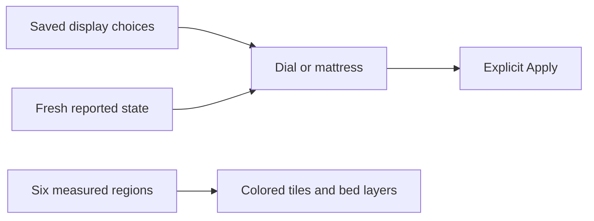

# Title

feat: add Sleepypod temperature modes and thermal mattress views

# Description

Add persistent Degrees, Offset and Eight Sleep display choices to the Waveshare remote, matching Sleepypod’s temperature conversions. Let Temperature switch between an 11-pixel dial and a rotatable mattress while preserving unapplied edits.

Color each mattress side from pale to saturated blue/red using fresh reported cooling/heating state. Rework Sensor Layers into a bed preview with six colored measurement tiles and immediate layer filtering. Keep missing/stale readings gray and all mutations behind explicit controls.

Validation: conversion/state and preference persistence tests plus 1,728 mesh configurations pass; 99 production-LVGL routes/state captures pass circular bounds and text-fit checks. ESP-IDF 5.5.5 build succeeds. Hardware release evidence and remaining live-control limits are documented in HARDWARE_CHECK.md.
