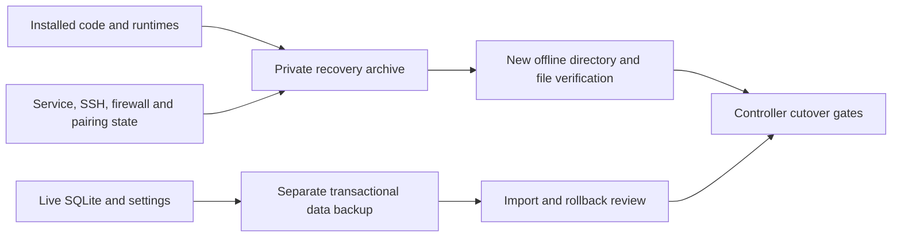

# Installation recovery before a Core cutover

`backup.py` preserves SQLite and user settings. `recovery.py` complements it
with the installed application, dependencies, service definitions and recovery
configuration. Neither tool stops services or switches controllers. The
installation tool requires an explicit plan; it never guesses which live paths
to overwrite. There is deliberately no automatic restore-to-`/` command.



## Capture and verify

The tool uses Python's standard library (3.9+). A private JSON plan names exact
absolute source roots and any excluded descendants:

```json
{
  "format": "free-sleep-recovery-plan/1",
  "roots": ["/home/dac/free-sleep", "/home/dac/venv"],
  "exclude": ["/home/dac/free-sleep/server/free-sleep-data"]
}
```

This small example is **not** a complete Pod recovery inventory. Inspect the
actual systemd units, process executables, loaded libraries, runtime paths,
firmware launch scripts and configuration before creating the real plan.
Capture source symlinks and their required targets separately; traversal through
a symlink in a selected root is rejected. Data, logs and continuously written
RAW recordings need their own retention plan, not a static installation copy.

On the Pod, with a new output directory outside the selected sources:

```sh
nice -n 10 python3 recovery.py capture \
  --plan /private/recovery-plan.json \
  --observations /private/read-only-inventory.json \
  --output /persistent/new-installation-recovery
```

The optional observations file can preserve read-only service states, executable
paths, firewall rule exports and mount information. It is copied privately and
checksummed. Do not include it in Git or public logs: service configuration and
the installation archive can contain credentials and host keys.

Copy the completed directory to private storage on another machine, then run:

```sh
python3 recovery.py verify --bundle /private/installation-recovery
python3 recovery.py verify --bundle /private/installation-recovery \
  --rehearse-to /private/new-restoration-rehearsal
```

Verification checks archive membership, contents, source ownership/permission
metadata and symlink targets. Hardlinked files are saved as independent files
with identical contents. A rehearsal writes regular files first and creates
symlinks last; no archive entry may be beneath a link. It never executes restored
code, changes service state or writes outside the new destination. Existing
outputs, links at bundle-file paths, traversal, duplicate entries, checksum
failures and unexpected special files fail closed with staging cleanup.

Rehearsal files use local owner-only permissions (0700 directories, 0600 files),
not the original executable/setuid modes or Linux ownership. Those original
attributes remain verified in the archive/manifest. `fileRestoreRehearsed: true`
therefore establishes file recovery only. `runtimeRestoreTested: false` and
`originalPermissionsApplied: false` remain explicit. An ARM executable restored
on a Mac is not evidence that the Pod booted or regained hardware control.

## Controller rollback procedure to qualify

Before switching, retain the original Free Sleep directory, Python environment,
Node runtime, data folder, service definitions and SSH listener. Install Core in
separate paths. Record every deliberate shared-file/service change in a cutover
journal with its original hash, ownership/mode and enabled state. Do not purge
the working installation or overwrite its runtimes.

The attended rollback must then establish:

1. Stop the new controller and its sensor/automation writers; verify their
   processes are gone before allowing the original controller to own DAC or
   Bluetooth. Keep the dedicated SSH service available throughout.
2. Restore only the journaled changes that are needed for Free Sleep, checking
   each current file against the expected deployment version. A blanket
   extraction over `/` could overwrite unrelated settings, credentials or OS
   files and is not a valid rollback method.
3. If original data needs restoring, stop all its writers, use the verified
   SQLite snapshot and handle its WAL/SHM companions as one stopped database.
   Keep the current data copy for investigation. Never replace a live SQLite
   file while a service holds it open.
4. Apply the recorded Linux ownership/modes to restored runtime files, restore
   the original service enablement/masking, reload systemd and start the original
   controller/stream service in their documented order. Do not unmask stock
   competing controllers merely because they appear in a generic installer.
5. Verify SSH, authenticated API/status, socket ownership and a fresh hardware
   report. Follow with attended thermal, presence and alarm tests. HTTP success
   alone does not prove physical recovery.

The data and installation captures are independently consistent snapshots, not
one atomic transaction or an eMMC/boot image. Refresh them after quiescing writers
at cutover, and record versions/change journals. Core compatibility, overnight
editing, alarm behavior, occupancy calibration, base/vibration qualification and
seven actual Preview nights remain separate gates.

The archive records basic ownership and mode bits, not filesystem ACLs, extended
attributes or Linux file capabilities. Any runtime dependency on those needs a
separate inventory and restoration check. Preserve the installed runtimes and
OS in place during the initial Core deployment rather than treating this file
archive as a replacement system image.

## Recorded Pod rehearsal — 25 October 2026

The live Pod's reviewed installation inventory captured 45,126 entries
(1,490,732,086 uncompressed bytes). It includes the selected application,
dependencies, runtime files, systemd definitions, SSH/firewall configuration and
stock base configuration. A separate Bluetooth-state archive contains 70 entries.
Both archives were copied to the Mac and fully verified after restoration into
new private directories. The installation archive SHA-256 is
`14a47913a01b8689395be4539f1757ad58dbdcf6edc983d6474b417b562734e3`.

A fresh transactional data backup separately passed the Core import rehearsal:
14 disabled power rows, 14 disabled alarm rows, six gestures and two Off comfort
states. Original source data remains alongside the candidate. Continuous RAW
sensor files were not included in the static installation archive.

Artifacts and the aggregate `verification.json` are private and outside Git in
`~/Downloads/FreeSleep-Installation-Recovery-2026-10-25/`. The Pod-side copies
remain in `/persistent/free-sleep-recovery-2026-10-25/`. The Mac's FileVault was
enabled, and all regular files/directories in the local recovery tree passed
owner-only permission checks; symlink targets were not followed.

After capture, Free Sleep, its sensor service, the dedicated SSH service and
Bluetooth were active with their original process IDs. An unauthenticated API
request returned 401. No controller was switched and no physical command was
issued. The aggregate report explicitly records `runtimeRestoreTested: false`
and `deviceBootImage: false`; attended operational rollback remains pending.

## Automated checks

```sh
python3 -m unittest discover -s scripts/tests -v
```

CI already runs this directory on Python 3.9 and 3.10. The recovery tests cover
regular files, hardlinked contents, absolute/relative symlinks and masked units;
private permissions; exclusions; changed files; missing/recursive/existing
targets; FIFO rejection; damaged archives/observations; duplicate/traversal
members; and links with descendant writes. These tests do not control a Pod.
The local 25 October run passed all 40 script tests, including 12 installation
recovery tests. CI results must be checked separately after publication.
